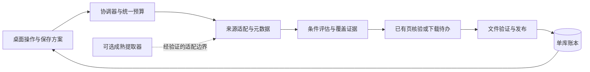

# 优化详细设计

> **2026-11-11 后续需求修订**：用户澄清本地缺图是上传网盘后主动腾空间。当前工作已转为[图库归档与空间释放](../../archiving/README.md)，以该目录及实施日志接续；本稿的“优先核验/补缺失”顺序不再直接执行。下面保留原讨论内容，审计发现及未实施状态不改写。

日期：2026-11-11。状态：设计稿，以下新增协议和行为均未发布。目标及阶段见 [README](README.md)。

## 1. 系统边界

继续使用现有 Tk 界面、来源协调器、下载工作者和单 SQLite 写入者。只有未来证明外部组件有明确收益时，才在来源边界引入适配器。业务规则、文件发布和本地账本不由第三方控制台文本决定。

图表示职责，不要求为每个框新增包、线程、服务或数据库。当前模块可承载的部分直接扩展；接口只为实际接入点建立。

## 2. U1-A：已有文件复核与修复

### 2.1 问题和语义

当前 `_find_reusable_artifact` 依据收据、品质、大小和摘要字段选记录，但未打开对应磁盘文件。审计已复现跨任务删图或等长替换仍被复用。旧详细设计 04 的“普通去重信任完成成果”是此问题的设计来源。[当前实现](../../../core/delivery_repository.py)、[原设计](../../refactor/detailed_design/04_RECORDS_AND_MIGRATION.md)、[审计 J-01](../../audits/2026-11-11/FINDINGS.md)

需要同时处理跨任务复用、同任务重放、恢复、名单聚合和显式库核验。只给一个查询函数加 `exists()` 不够：它查不出等长替换，还可能让同任务其他捷径继续误报。

分开保存两个事实：

| 事实 | 含义 | 更新方式 |
| --- | --- | --- |
| 历史交付事实 | 某时收到了指定页、原图策略、字节数和摘要，完成发布记账 | 原记录保留；新修复产生新代次及关联 |
| 当前文件观察 | 某次检查该路径缺失、相同、改变、不可读或根目录不可用 | 新观察追加；当前状态是观察投影，不改写旧批次结果 |

作品“本次范围完整”取决于所需各页在本次策略下的有效观察；某次历史下载成功数不能据此被倒扣或删除。

### 2.2 两种核验策略

| 策略 | 检查 | 界面表述 |
| --- | --- | --- |
| 完整核验，建议新任务默认 | 路径边界、根可用性、普通文件身份、大小、完整 SHA-256；比较前后文件状态 | “本批已核验 N 页”，显示检查时间 |
| 快速复用，显式选用 | 根/路径/文件身份、大小、mtime 等快速属性；必要时升级完整核验 | “快速检查后跳过 N 页”，注明不保证发现等长内容改动 |

不使用“快速检查等价于内容未变”的说法。只抽首尾片段也不是完整 SHA-256，不作为严格模式的替代。

完整核验只处理本批实际触达的已有页；全库巡检是单独可暂停的操作。单批相同 artifact/文件代次只核验一次，后续引用复用本批证据；跨会话不能仅凭缓存 mtime 把快速证据升级成严格证据。同会话去重也应检查可见文件身份变化并失效缓存；已通过检查不等于此后外部程序永远不能修改。

核验工作量有独立的文件数、读盘字节、时间预算。达到预算时保存 `verification_pending`，不算完整、不静默退回弱检查，也不无限占用下载批次。原本“最多新增 N 个作品”的额度继续指新增/补齐；核验量单独展示，不能因大量旧图无须新增就失去本批边界。

### 2.3 核验流程与并发边界

1. 由现有查询/协调边界读取需核验的有限页引用，冻结 artifact ID、摘要、PathRef、策略版本和 revision。
2. 先核对根目录映射。外置磁盘未连接、根权限异常、卷身份不符时标 `root_unavailable`，暂停该根的核验/修复；不能把整个目录当成数万张丢失。
3. 在文件 I/O 所有者中解析路径，逐段检查链接/reparse point 等边界，打开普通文件；尽可能通过同一已打开句柄读取身份、大小与摘要。不能依赖字符串前缀或先检查后随意重开。
4. 流式计算摘要，每块检查取消和时间预算；检查前后文件身份、大小、变更信息。读取期间变化标 `changed_during_check`，保留待核验，不接受混合版本。
5. 交回小型观察结果，由唯一写入者在短事务内按 revision、artifact 代次和策略版本比较后提交。过期结果不能覆盖较新的修复、路径重映射或核验结果。
6. 提交后发布界面快照。哈希、目录探测、网络、解码均不得放进 SQLite 写事务或 Tk 回调。

跨文件系统与数据库仍存在时间窗口，不能把 CAS 描述成对用户外部修改的原子保护。正式结论始终带“核验于某时”；无法可靠取得文件身份时保守返回待核验。受控竞态、链接替换、根重映射必须进入测试。

### 2.4 本地状态与操作

| 状态 | 默认结果 | 可用动作 |
| --- | --- | --- |
| hash_match | 本批可按严格策略复用 | 打开位置、查看证据 |
| quick_match | 仅快速策略可复用 | 完整核验 |
| missing | 不报完整，保留旧成功记录 | 补齐缺失、定位新目录、标记有意移除 |
| changed | 保留现有文件，不覆盖 | 保留当前文件并另存原图、人工确认后替换、重新定位 |
| unreadable / root_unavailable | 不猜丢失、不自动重下 | 重试本地检查、修正目录或权限 |
| changed_during_check | 证据不稳定 | 稍后重试，超过本批预算暂停 |
| unknown / legacy_unverified | 没有可比较的可信摘要 | 显式纳入并建立新证据，或重新下载；不能声称匹配历史源文件 |

核验按钮默认只检查，不联网补图。用户选择“补齐缺失”后生成范围明确的修复任务；可以把自动补缺失保存到指定方案，不能因手工删除一次就无休止下回来。

“有意移除”保存工作/页与指定根的排除意图，可撤销；不删除旧记录，也不自动对其他根生效。画师取消关注同样不是删图库指令。

修复采用当前下载、验证、prepared 与发布协议：临时文件完整后生成新的交付代次。已有未知归属或被修改的同名文件不覆盖。路径已被其他程序重新创建时转冲突处理。修复失败不丢旧文件；远端不再可访问时保留 `unavailable`，不能靠重试抹平原因。

### 2.5 数据设计与迁移

建议最小增量是“页核验任务/观察记录”和 artifact 当前健康投影，优先复用既有事件、预算与工作队列。精确 DDL 在 U1-A 开始前结合实际查询计划定稿，不另起全库索引服务。

观察至少包含：artifact ID、根映射版本、文件代次/身份、期望与实际大小、摘要算法和值、策略版本、检查时间、结果和安全原因码。禁止保存凭据或完整会话响应。摘要不是独立备份，数据库丢失也会丢验证依据，备份方案必须覆盖账本。

来源候选被接纳时，可以持久化“核验待办”后推进候选确认，但不能直接写为已有完整。已持久化的待核验项必须在重启后可继续，不能游标前进了而核验只留内存。核验发现需要下载时，再按新增作品预算预留修复名额；同一作品在同批不重复占额，额度不足保持待修复。

新配置使用独立的 IntegrityPolicy 版本，旧 request_json 与历史 fingerprint 不原地重写。恢复旧任务必须说明其原策略；需要按新策略续做时生成关联任务/核验轮次，先复用已知范围，保留旧断点。旧策略结果不得在新 UI 自动重标为严格核验。

迁移时持单写锁、创建一致性备份，在副本演练 schema 升级、索引、崩溃恢复和未来版本拒写。旧程序不可写新结构；回退要先保全升级后产生的记录和原图，不能只覆盖一份旧数据库了事。

## 3. U1-C：质量证明与深度解码

质量拆为来源、传输、结构/解码、页集和后续完整性。验证标签必须可追溯，不把 SHA-256、文件能打开和原图质量混成一个布尔值。

| 证据 | 能说明 | 不能说明 |
| --- | --- | --- |
| original 来源策略 | 使用当前元数据指定的原图，未主动换小图 | 平台没有处理过作者源文件 |
| 长度/Range/版本检查 | 传输满足已知响应契约 | 服务器返回内容一定就是目标作品 |
| 结构校验 | 支持范围内的容器和数据结构满足规则 | JPEG 等所有像素一定完整可解码 |
| 深解码 | 指定解码器能在限制内完整读取约定帧/页 | 远端原件真伪或绝对没有任何损坏 |
| 本地摘要一致 | 当前文件与曾记录的字节相同 | 来源最高质量、数据库本身可信或未来永不变化 |

建议评估 Pillow 等成熟解码器，而不继续手写完整解码器。候选应为一个经过核查的固定版本，复用现有 Python；是否安装、包大小与兼容性在实施前按环境规则处理。

深解码只读原文件，不 `save()`、旋转、压缩、去元数据或改 ICC。`Image.verify()` 并不等同于像素解码；需按支持格式完成 `load()`，多帧格式逐帧验证并有帧数限制。资源限制包括文件字节、宽高/像素、帧数、解码时间与内存；超限是“未完成核验”，不是“文件损坏”。不打开允许截断的全局选项，不禁用解压炸弹防护。[Pillow 官方定义](https://pillow.readthedocs.io/en/stable/reference/Image.html#PIL.Image.Image.verify)、[资源限制说明](https://pillow.readthedocs.io/en/stable/reference/Image.html#PIL.Image.open)

原生解码调用不能仅靠线程取消保证及时退出。若要宣称硬超时/内存上限，需用受限独立工作进程并验证 Windows 终止与回收；未做到时明确是软限制。仅在这一特定能力证明有收益时增加该所有者，避免为每张图起进程。相同摘要及相同验证策略可复用解码结论，无需每次扫描重新解码。

没有安装解码组件时继续明确显示结构级别；用户选择严格解码策略而组件缺失时应报告能力不可用，不悄悄接受。新能力不把旧结构检查收据批量提升等级。

## 4. U2-A：关注历史的覆盖与更新

### 4.1 完成结果必须有范围

保存并展示：账号引用、公开/私密范围、关注快照时间、画师 ID、来源/接口、作品类型、筛选版本、扫描时间区间、分页结束证据、未决数与停止原因。

推荐摘要示例：

> 本轮已检查 30 位画师。确认当前范围处理完 22 位；5 位待继续，2 位有失败页，1 位覆盖待核对。新增 100 个作品、保存 173 页；已有 420 页通过完整核验。筛选排除 81 件，字段未知 3 件。达到本批请求预算。

示例数字是设计数据。预算结束、空交集、首屏全被过滤都不表示远端全集已穷尽。页面不显示无法证明的总量分母。

分别表示 `enumeration`、`decision`、`delivery/integrity` 状态：来源遍历完但有失败页，应该显示“查找结束，保存未齐”；有意过滤的作品不计缺页，但覆盖摘要说明哪些条件被排除。缺失元数据不当作 0 收藏或非 AI。

### 4.2 从 gallery-dl 借鉴的集合对账

其固定快照会读取网页 `profile/all` 的作品 ID，与 App API 画师枚举结果结合，用于部分可见性差异补漏。JpgPng 可先把这一思路作为只读对照，而不是加一个遇到错误就换接口的无限回退。[固定提取器](../../../../references/pixiv_downloaders/2026-11-11/gallery-dl/gallery_dl/extractor/pixiv.py)

对账流程：冻结各自观察时间与账号 → 有界读取网页/App 集合 → 计算差集 → 查明差异是类型、权限、时间变化、删除或接口缺漏 → 仅对需要的 ID 补查。两套结果不是同一服务器快照，不将所有差集直接算漏图。

网页账号身份必须与目标账户一致；网页登录失效不扩展为自动提取其他浏览器账号。网页集合响应需有长度/数量上限和结构验证，失败不替换已有完整快照。不完整关注列表不能用于推断取消关注。

正常历史续跑沿现有断点；新关注加入待补，旧画师进度保留。新作水位、重复分页和候选入库规则沿用现有实现。周期性历史复查由明确操作/保存方案触发，避免每次启动扫描全部画师；账户限流由所有来源共享停止/冷却。

### 4.3 作品修订与远端变化

作品 ID + 页号不能永远代表不变字节。若新元数据明确显示页数、来源版本或稳定资源身份变化，记录为需复核的远端修订，保留旧 artifact。临时 URL 参数变化不直接触发重下；无法证明远端版本相同时显示未知，不伪造版本保证。已删除或权限改变的作品保存最后观察结果与时间，用户可继续保留既有原图。

## 5. U2-B：筛选、保存方案与结果解释

### 5.1 先修易用性

沿用现有独立开关和 AND 组合。在开始前显示简短生效摘要，例如“关注历史 · 原图全页 · 收藏 ≥1000 · 排除 AI · 每批新增/补齐 100 件”；不要求用户打开多层窗口确认条件。

结果表提供原因列和按原因过滤：收藏不足、AI、未知字段、无权访问、未支持类型、原图获取失败、本地需核验。允许选中原因执行有限的重查/重试，而不是从头再跑整批。下载名单继续独立于滚动日志。

保存方案包含内容条件、输出策略、完整性策略和资源起点。运行任务读取不可变快照；修改方案影响下一次创建/续接的适用版本，不能改掉正在执行任务。关闭程序后仍能恢复用户明确保存的方案；临时表单草稿单独标识。

提供无图片“试算”：先用已缓存元数据解释命中/排除；若范围不够，显示覆盖不足，另可选择有请求预算的元数据试查。缓存试算不能用过期收藏数声称当前搜索全集都满足。

### 5.2 按收益增加条件

| 候选条件 | 数据来源与语义 | 优先级 |
| --- | --- | --- |
| 作品类型 | 元数据类型；不支持的类型明确告知 | 较高，原图范围需要 |
| 包含/排除标签 | 原始标签列表；包含组内任一匹配，排除任一命中即排除，各条件组再 AND | 可选下一批 |
| 发布时间范围 | 服务端带时区时间，区分检索接口条件和本地判定 | 可选下一批 |
| 原图尺寸/长宽比 | 以所选页原图数据为准；多页明确“全部选定页满足”或用户选用“至少一页” | 有真实需求后做 |
| 收藏数区间、页数 | 未知值保留未知，收藏数有观察时间 | 现有条件稳定后扩展 |

标签先支持字面匹配；规范化原始值与比较值分开保存，可采用 Unicode NFC 与约定的大小写规则。不把翻译标签当可靠同义词，不给用户自由代码表达式。维度筛选不应靠先下缩略图才能判断；必要的详情补查共享缓存和预算。

已知任一硬条件不满足即可排除，无需为其余未知字段继续请求。一次详情请求补足所有当前必需字段；纯展示字段缺失不补查。条件放宽时可离线重评已有候选，再查询未覆盖范围；条件收紧不删除已下载文件。收藏增长后是否重新检查旧过滤作品要单独显示，不将增量新作误称重新筛过整个历史。

## 6. U3：成熟引擎的接入选择

### 6.1 三条路线

| 路线 | 实施内容 | 收益 | 主要成本 | 决策 |
| --- | --- | --- | --- | --- |
| A 借鉴方法 | 保留现有运行链，借鉴补漏、维护、配置和事件设计 | 改动最小，不带额外运行体积 | Pixiv 接口仍由我们维护 | U1/U2 的基线方案 |
| B 借用提取层 | 第三方输出作品/原图元数据，现有交付和账本负责落盘 | 分担来源适配；保留严格发布规则 | 认证、分页、请求预算、异常及版本适配 | 优先研究与对照，不预定采用 |
| C 借用完整下载层 | 第三方写隔离 staging，JpgPng 独立验证、发布、入账 | 更多下载功能交给成熟组件 | 双重恢复、错误语义、Range 安全、staging 磁盘成本 | B 不足且收益明确时再研究 |

不同时把 A/B/C 都做成永久可切换后端。不以“接入成功”作为价值证明；需要说明以后可以删减/停止维护哪些已有代码，或者补上哪个确有价值的能力。

### 6.2 本轮新增的静态发现

gallery-dl `1.33.0-dev` 固定源码 `DataJob` 中：

- `output.jsonl` 会逐条输出，但 `handle_url`/`handle_directory` 仍向 `data` 等列表追加；不能据 JSONL 推断内存始终有界。
- `run()` 的提取异常会写入内部错误信息，结尾仍返回 0；外层不能把进程退出 0 单独认定为完整枚举。
- API 层业务限流存在等待后重试循环；仅设置 HTTP retries 不覆盖全部业务循环。

这是对已下载开发快照的静态判断，非本轮动态复现，也不扩大成全部稳定版结论。[DataJob](../../../../references/pixiv_downloaders/2026-11-11/gallery-dl/gallery_dl/job.py)、[Pixiv API](../../../../references/pixiv_downloaders/2026-11-11/gallery-dl/gallery_dl/extractor/pixiv.py)

因此不能把 `gallery-dl -j` 的 stdout 简单接到 GUI 就宣称已完成 B。普通 CLI 只适合先做严格有界的资料对照；生产适配必须有完整的终止、错误和预算契约。

### 6.3 接口契约草案

最小来源结果：`source/version/account_ref`、规范化作品 ID/作者 ID/类型/页数、每页原图引用、观察到的筛选属性、分页进展证据、错误/停止原因。只允许明确的 Pixiv 来源，不把用户输入任意 URL 分派到全部站点。

事件至少区分 `candidate`、`request_attempt`、`checkpoint`、`warning`、`terminal`。末尾必须有可验证的终态：耗尽、预算暂停、取消、认证失败、限流或异常。收到候选后崩溃、只有退出码、只剩半行 JSON、缺 terminal 均表示不完整。

终态还需由分页/集合证据支持，不能包装器无条件补一个 `complete`。外部游标不直接写入既有游标结构；重放采用稳定 ID 与已确认范围。队列背压不得使来源继续无限抓取。

如采用子进程边界：固定程序/版本、参数数组且不经 shell、关闭默认配置搜索（固定源码选项为 `--config-ignore`）、不加载自定义 exec/插件，stdout/stderr 分开有界读取，日志脱敏；取消应能清理工作进程树。凭据不得放命令行或 stdout。若需认证文件，使用专门受保护的本地机制，不能放公开报告或可分享的通用临时配置中。

如采用同进程库接口：先证明可隔离其全局配置、日志和会话，不依赖未核验的内部 API 长期稳定；必须能在每个真实请求前记账并取消。用户配置文件不能覆盖我们规定的原图、路径和安全策略。

仅父进程墙钟超时无法保证准确的请求上限。若库内隐藏请求/重试无法约束，B 的生产接入门槛不通过；不能通过数输出作品猜请求数。若需要长期 fork 网络、认证、分页和下载等多层，重新评估是否还有减少维护的收益。

### 6.4 完整下载层额外条件

C 必须关闭品质降级，选定固定稳定版重新验证审计问题；未知或不受控的续传应禁用并重取完整文件。不能仅靠最终图片能解码来弥补不正确 Range 拼接，也不能仅靠 exit 0 或第三方 archive 入库。

第三方只写专用 staging；最终 PathRef、冲突处理、质量证据和正式发布由单一所有者完成。第三方 archive 是优化缓存，JpgPng 账本是产品结果依据，避免两个系统互相把“对方说完成”当事实。staging 片段和恢复证据按业务待办保护，不作为普通缓存自动删。

更新须固定版本、摘要、兼容清单与回归小样；不在下载时自更新。复用源码或随包分发时核对其 LICENSE 及第三方声明，保留相应材料；独立进程不自动消除分发义务。具体分发方案确定后再核对许可证边界，本轮不作法律结论。

## 7. U2-C：性能与可操作性

现有有界队列、短事务、Tk 主线程和增量日志已存在；优化顺序是测量 → 找占比最大的成本 → 小改 → 同输入复测。

| 成本 | 可尝试优化 | 不接受的捷径 |
| --- | --- | --- |
| 已有文件核验 | 单批去重读取，顺序/局部性调度；下载忙时降低核验优先级 | mtime 冒充 SHA-256、随机抽样冒充全量核验 |
| 元数据请求 | 字段依赖合并，按账号/作品/版本的有界缓存；展示字段不补查 | 过期收藏数作永久结果、共享不同账号的私密可见性缓存 |
| SQLite | 针对执行计划补索引、小批提交、读事务及时结束 | 关闭关键耐久性、长事务内等网络/哈希 |
| 日志和 UI | 现有快照 revision、折叠日志不绘制、原因聚合 | 每张图重建全表、刷新时查整个历史 |
| 网络并发 | 固定总并发、共享请求节拍、同条件试验 | 为测速提高账户压力、每个来源各自绕过全局限流 |
| 文件验证 | 同一摘要/策略复用解码证据；流式算摘要 | 把原图全部载入内存或跳过必要检查 |

新增核验默认最多一个本地扫描所有者，队列只保存引用；下载/核验总资源预算统一。实际并发起点沿用合法旧设置，不为了设计表格强制重置。读盘吞吐、等待时间、请求数、失败原因与 UI 延迟采用有界聚合，不新增全量高频事件库。

交互保留现有导航，在记录页增加“核验此范围”，任务页增加“本批结果/待处理原因”。目录选择仍用系统弹窗，错误贴近字段。批量修复先展示范围和冲突，再执行所选项；避免每页弹框。首页继续以“继续历史补全”为主动作，完整性政策只用一行可理解的说明，不把线程、数据库、引擎参数堆给普通使用者。

## 8. U4 候选拓展

### 8.1 动图原件

先设计原始资源包，而不是默认转换 GIF/MP4。按平台实际提供的 ZIP 或更高质量独立帧及其可验证元数据保存，记录帧顺序、时长、总帧数、画布和来源版本。ZIP 内的帧可能已经是 JPEG；不能把“无损 ZIP”说成所有帧都为最高质量。

原件与派生预览分开；转换不覆盖原件。ZIP 目录遍历、重复文件名、解压总量、单帧大小、非法时序和缺帧需要验证。不为原件归档默认安装 FFmpeg。此扩展必须另做类型、记录和恢复验收，不能只开放一个复选框。

### 8.2 下载 CLI

现有 `organize.cmd` 是账号整理，不等于通用下载 CLI。如果用户确实需要无界面批次，可给现有协调器加薄入口，复用相同命令、锁、预算和结果 JSON；避免另写下载逻辑。输出先定义业务终态与退出码，借鉴成熟工具的程序接口，而非解析 GUI 日志。当前不为了形式齐全立即增加入口。

### 8.3 多图分类

沿用 E1-3 的小样 → 分类规则 → 证据 → 计划 → 网站写回/读回步骤。样图按需，和原图下载队列/目录分开；保留网站人工修改，冲突时不覆盖。现阶段没有自动视觉模型运行体；不把已获取样图描述成已看完并分类。后续按明确画师范围开展，见[原扩展设计](../../refactor/detailed_design/08_FOLLOW_ORGANIZER_EXTENSION.md)。
