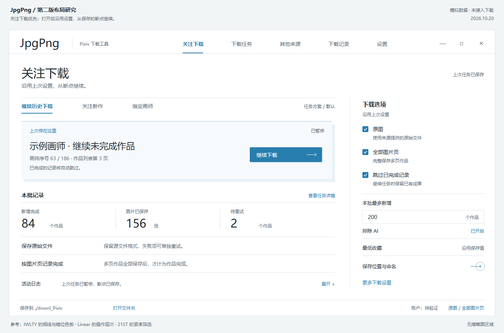
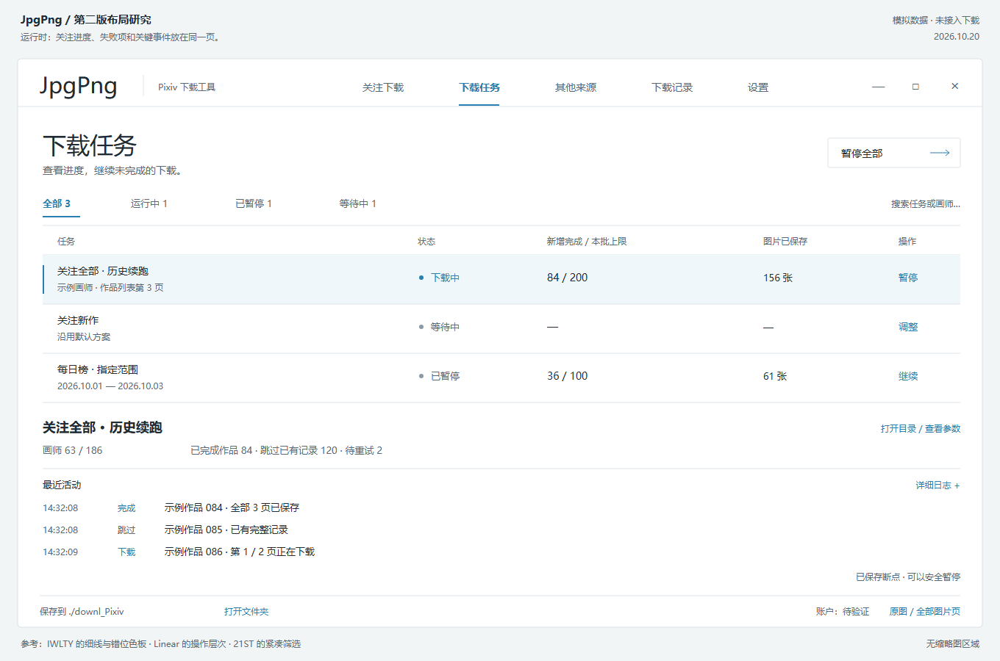

# JpgPng 重构方案：下载质量优先、关注直下、轻量界面

初稿日期：2026-10-20；详细设计衔接更新：2026-10-21  
状态：2026-10-21 用户已授权分阶段重构，允许替换不适合的旧记录结构并接受必要时重下；原先停在 P2，现已明确恢复并验收 P3/P4 离线核心。“关注画师整理”作为 E1 独立推进，实施状态见[重构进度](REFACTOR_PROGRESS.md)；已有诊断和草图保留为依据。  
适用项目：`JpgPng/`，当前产品名称 PiDL / ImageTool-Lab。本文业务路径均以项目根目录为基准。  
第 1 节列出用户已明确的需求约束。后续接口、数据、交互与工作包见 [详细设计总览](detailed_design/README.md)；其中工程默认值标为设计基线，不冒充用户已逐项确认。

## 1. 已确认的优先级与主流程

2026-10-20 用户明确纠正了第一版方向：

1. **下载图片的质量第一，性能第二，易用性和美化随后。** 质量包括拿到真实原图、保留源文件、不漏图片页、完整保存、记录可信；作品审美或收藏筛选沿用用户设置，不能由程序替用户改变喜好。
2. **以关注下载和直接批量下载为主，下载界面不做预览图。** 日常下载流程不增加先看图再选、缩略图网格及其下载/解码/缓存。独立的 AI 画师整理任务需要按需查看多张作品，其采样与下载主流程分开，见 [08 关注画师整理扩展](detailed_design/08_FOLLOW_ORGANIZER_EXTENSION.md)。
3. **轻量、项目内实现、相对路径。** 默认复用现有 Python 环境，新增运行依赖目标为 0；不为 UI 新建 Node、前端工程或专用环境。
4. 用户允许大幅调整原结构，甚至整体重构；旧草图、配色和框架候选均不必保留。授权允许合理实施，但已有业务数据、断点和用户修改仍须保护。
5. 视觉先看本地 `IWLTY`、`21ST` 和更多网站，再结合下载工具的实际流程。只提取适用的设计方法，不为了效果引入大量包。用户表示少于 10 个新增包尚可接受，这不是需要凑满的数量，也不只计算顶层包。

2026-10-21 用户进一步确认：**关注画师的历史作品逐步收全、关注新作，两种模式都要；默认选择历史作品逐步收全。** 用户经常新关注画师，希望持续积累他们的作品，因此历史补全是日常主流程，不只是首次使用时的一次性导入。

据此建议的主流程是：**打开关注页（默认历史补全）→ 沿用已保存设置 → 开始或继续补全 → 查看进度与失败项**。“关注新作”保留明确入口；打开页面本身不自动发起采集。已有任务续跑沿用自身模式和断点，不因切换入口丢失历史进度。

规划需要覆盖新关注画师加入补全队列、已有画师继续断点的场景；新画师的排队优先级尚待讨论。

2026-10-21 用户进一步明确：**下载模式与筛选条件可以叠加，筛选为可选项；下载完成后保留方便查看的下载名单。** 历史补全与收藏数、排除 AI 等不是二选一。不开启属性筛选时，以当前可访问、程序支持的全部作品为目标；开启后，逐步收全符合所选条件的作品。既有设置继续保留，不因默认历史补全而清除或强制启用筛选。

本版撤回第一版的“预览优先”“Eagle 式图片网格”“优先评估 PySide6 新视图”和“先做排行榜完整路径”。目前建议优先评估 **Python + Tkinter/ttk + 本地轻量绘制**，以复用环境和减少依赖；这项建议尚未作为实施定案。

当前已建立总体规划、核心详细设计和关注画师整理扩展计划。完整功能重构尚未完成，实际进度与停止边界统一见[实施进度](REFACTOR_PROGRESS.md)。本文保留总体意图和研究依据；具体实施阅读 [详细设计](detailed_design/README.md) 与 [工作包及验收](detailed_design/07_IMPLEMENTATION_AND_ACCEPTANCE.md)。

### 1.1 2026-10-21 新增：AI 整理真实账号中的关注画师

用户希望由 AI 查看每位画师的多张作品并整理 Pixiv 账号里的关注分组，自己在 Pixiv 网站检查和调整。只生成本地分类名单不能作为这项需求的交付。工具作为 JpgPng 内独立运行的轻量扩展，复用现有环境；下载质量、性能仍优先。

用户先明确只执行“第 1 项：加入重构计划”，完成 E1-0 后另行要求继续，已补充 E1-1 的基础可行性小样。范围、阶段、未验证能力和验收标准统一在 [08 扩展计划](detailed_design/08_FOLLOW_ORGANIZER_EXTENSION.md) 定义。正式工具实现排在下载主流程稳定后，再分批整理和下载联测；扩展小样不自动恢复主线 P3，也不代表完整分类或可重启 CLI 已交付。

## 2. 旧文档里的要求怎样继承

阅读依据包括项目 README、使用说明、`.kiro/specs/jpgpng-optimization/requirements.md`、当前架构/下载/数据保护历史、审计记录，以及归档内的 UI、日志和关注续跑原始方案。归档只读取了相关文档，没有解包到运行目录。

旧审计中的“已修复”属于历史结果，不能直接当作当前仍然存在的 bug；旧测试通过记录也不能代替本次验收。尤其是日志控件代理、日志轮询异常后继续调度等已有修补，本轮不把它们重复列为已确认故障。

| 既有要求 | 重构约束 | 验收要点 |
| --- | --- | --- |
| 搜索、画师、关注新作、关注全部、排行榜、相似推荐、个性化推荐 | 保留入口与能力；允许重组页面 | 七种来源使用一致的参数说明、任务状态和统计口径 |
| 中文界面、设置持久化、路径不依赖启动目录 | 保留 | 从任意工作目录启动，配置仍定位到本项目 |
| 原图与多页 | 保留严格原图语义；明确作品数和图片页数 | 原图元数据不足时报告失败；不能悄悄降级为预览图 |
| 不能因为 p0 或单个 ID 存在就漏掉缺页 | 保留页级状态与补页能力 | 三页作品只完成一页时，剩余页可恢复 |
| 已完成记录可能对应用户搬走的文件 | 保留当前“信任已完成记录”的兼容语义 | 正常去重不因文件被搬走就全量重下；文件核验是独立操作 |
| 入队前持久化，失败和中断可恢复 | 主窗口已有能力必须保留，并统一到其他入口 | 故障重启后待办仍在；重复恢复不能重复记账 |
| 下载记录及可读名单 | 新核心统一单库，旧历史可选导入；不强制实时维护所有旧 JSON/Markdown | 导出失败不改变成功事实；名单区分本批与累计，旧原件保留 |
| 关注全部的画师/分页/作品游标、预算和暂停 | 保留已有断点及身份检查 | 中途暂停后从正确位置续跑，不能总从首位画师开始 |
| 收藏阈值、排除 AI、按画师分目录、自定义命名 | 保留；筛选条件独立可选，可与历史补全、关注新作叠加 | 所有入口含义一致；字段缺失与数值为零分开处理 |
| 记录和下载库保护 | 保留 | 迁移先生成可核验备份；不把业务目录当缓存清理 |
| 运行日志可追踪 | 调整为明确的保留策略和真实的导出说明 | 界面只保留近期显示，磁盘保留范围和截断情况可见 |
| 历史视觉方案 | 不再作为必须保留的约束；根据用户参考重新设计 | 用细线、字体和布局实现美观，避免一排排通用圆角卡片 |

数据保护位置以工作区 [workspace.json](../../../workspace.json) 为准，尤其是下载库、下载记录、断点、备份、配置和认证文件。复用工作区现有解释器，保留 `PYTHONNOUSERSITE=1`；不把本机解释器的盘符写入业务代码。

### 2.1 下载质量先过这道门槛

| 要求 | 实现原则 | 验收 |
| --- | --- | --- |
| 原图真实性 | 优先使用接口提供的每页确切原图地址；缺元数据时补齐，不把预览地址当成功结果 | 原图模式拒绝静默降级；混合扩展名、多页不规则 URL 都正确 |
| 文件不被再加工 | 流式保存来源字节，保留原始格式；不缩放、不转码、不做“画质增强” | 下载输入与落盘内容一致；不能把所有扩展名强改为 JPG/PNG |
| 响应确实为图片 | 校验状态与已知错误类型、格式标记；MIME 缺失或 `application/octet-stream` 不能单独判错，需要结合内容 | HTTP 200 的 HTML/JSON 错误页不能记为图片成功 |
| 传输完整 | 对可信长度做校验；未知长度与弱验证明确区分；失败不留下被误认完成的正式文件 | 截断响应、零字节、超时、磁盘满均不产生假成功 |
| 续传正确 | 校验 206 的 `Content-Range` 起点、区间/总长和版本信息；200 全量返回不得追加到旧片段 | 返回错误起点即拒绝拼接；远端内容变更时安全重下 |
| 完成写入可恢复 | 设计同目录临时文件与完成提交顺序；完整后再切换正式文件名和页状态 | 进程中断不把半文件当完成；跨文件/数据库步骤可对账恢复 |
| 多页完整 | 每页单独记录结果，所需页全部成功才完成作品；不能只看 p0 | 部分页失败可单独恢复，不重复下载已完成页 |
| 去重可信 | 普通任务保留已有“可信完成记录可对应被搬走文件”的语义；新文件校验与历史核验分开 | 不为提升校验强度自动扫描、重下整个旧库 |
| 不以美化消耗下载资源 | 无图片预览请求，界面只消费任务元数据和统计 | 打开/切页不请求缩略图、不读原图来展示 |

格式标记和长度检查是低成本防错，不能声称证明完整可解码。PNG 的结构/CRC 等可用流式标准库校验；JPEG 等格式的深度解码需要单独评估成本和依赖，不能用“文件头正确”冒充全文件校验。首轮先封住可确认的错误响应、错误续传和半文件假成功路径。

质量改动首先在模拟响应和隔离文件上验证。即使外观完全不变，只要减少漏页、错图和假成功，就是首批的有效交付。

## 3. 当前问题清单与证据

证据分为四类：

- **离线复现**：调用当前实际方法，以模拟数据/线程代替网络和业务数据。
- **源码确认**：可以直接确认控制流程；还没有测量真实发生频率和用户影响。
- **风险待测**：实现存在可疑边界，需要专项复现。
- **用户反馈**：真实体验问题，但当前还不能确定唯一原因。

下表优先级表示实施先后，不表示已经发生数据损坏。P0 先做下载完整性、恢复与资源收尾；P1 做性能和流程一致性；P2 做界面美化。新增的质量复现仅针对模拟响应，未扫描或断言真实库存在坏图。

| 编号 | 优先级 / 证据 | 当前行为及影响 | 依据与修正方向 |
| --- | --- | --- | --- |
| Q-01 | P0 / 离线复现 | 底层下载函数接受 HTTP 200 的 HTML 正文并返回成功 | [download_engine.py](../../core/download_engine.py) `download_file`；增加响应类型与内容检查 |
| Q-02 | P0 / 离线复现 | 请求从第 4 字节续传，返回从第 0 字节开始的 206，最终长度碰巧正确时仍报成功 | 同函数；校验 `Content-Range` 及远端版本，不能仅比较最终长度 |
| LOG-01 | P1 / 离线复现 | 清空日志只清显示缓冲，队列里的旧消息下次刷新又出现 | [主界面布局](../../gui/pixiv_downloader_layout_mixin.py) `_clear_log`，约 950 行；用事件序号记录清空边界 |
| LOG-02 | P1 / 离线复现 | 单次刷新限制 400 条消息，但一条可含很多行；400 条各 100 行会一次处理 40,000 行 | 同文件 `_process_log_queue`，约 1090 行；增加时间、行数和字节预算 |
| LOG-03 | P1 / 源码确认 | 显示缓冲有界，但 `SessionLogQueue` 本身无上限；写磁盘仍发生在生产线程 | [logger.py](../../utils/logger.py) 约 68、110 行；分离落盘与 UI 通道，明确背压 |
| LOG-04 | P1 / 离线复现 | 磁盘轮转会淘汰最早分卷，导出却称“完整会话” | 同文件 `read_session_text` 与主布局 `_export_log`；真实表述保留范围，按流导出 |
| LOG-05 | P1 / 离线复现 | 同进程、同一秒创建两个日志实例会得到相同文件路径 | 会话名仅时间到秒加 PID；新增唯一实例标识。未验证文件损坏 |
| LIFE-01 | P0 / 离线复现 | 子窗口关闭会发停止信号，但立即销毁窗口、关闭日志；模拟工作线程仍存活 | [多来源界面](../../gui/pixiv_multi_filter_ui_mixin.py) `_on_close`，约 498 行；窗口退出与任务终止分开 |
| RANK-01 | P1 / 离线复现 | 数量上限在每个日期重新计算；设 2、选 3 天，可入队 6 个不同作品 | [排行榜范围](../../core/pixiv_fetcher_ranking_mixin.py) `_fetch_ranking_range` + [分页队列](../../core/pixiv_fetcher_queue_mixin.py) `_fetch_and_queue`；定义跨日期全局预算 |
| FETCH-01 | P1 / 离线复现 | 格式正常但作品列表为空，也会安排 15、30、60 秒重试，难以分辨正常空结果和限流 | 分页队列 `_load_initial_result`，约 147 行；引入明确结果类型和重试依据 |
| MULTI-01 | P0 / 源码确认 | 多来源界面自行创建线程池，未统一接入主窗口的持久化下载队列 | [多来源运行逻辑](../../gui/pixiv_multi_filter_runtime_mixin.py) `_download_all`，约 188、309 行；统一提交任务 |
| MULTI-02 | P1 / 源码确认 | 各来源取有限样本后求交集；“无结果”并不等于所有历史中不存在交集 | 同文件 `_run`，约 72 行；明确每来源覆盖范围和截断原因 |
| MULTI-03 | P1 / 源码确认 | 多来源中的关键词搜索没有传入主搜索的热门排序参数 | [multi_filter_fetch.py](../../core/multi_filter_fetch.py) `_fetch_search`，约 76 行；共享查询协议 |
| SEARCH-01 | P1 / 源码确认 | 热门排序且收藏阈值 ≥ 1000 的分支采用很小的探测预算，零结果时还会进入其他来源 | [fetch_strategies.py](../../core/fetch_strategies.py) `_search_main_query`、`_search_keyword_fallback_chain`；不把一次探测当作完整搜索 |
| SEARCH-02 | P1 / 源码确认 | 登录成功只显示已登录，未找到明确的 Premium 能力状态；排序失败存在改用日期排序的分支 | [运行逻辑](../../gui/pixiv_downloader_runtime_mixin.py) `_login`、[搜索逻辑](../../core/pixiv_fetcher_search_mixin.py) `_search_illust_with_sort`；显示实际账户能力与实际排序 |
| UI-01 | P2 / 源码确认 + 用户反馈 | 排行榜使用接口代码和手输日期；大量设置、状态和日志集中在大表单，子窗口另起一套流程 | 主布局排行榜区约 449 行；建立固定导航、独立榜单页和任务中心 |
| LIFE-02 | P0 / 风险待测 | 主任务收尾超时后仍可能有线程未退出；关闭共享 HTTP 会话对其他任务的影响需验证 | 运行逻辑 `_join_download_threads`，约 505 行；限定资源所有者，明确超时状态 |
| PERF-01 | P1 / 用户反馈 | 整体卡顿、易用性差，缺乏真实操作的延迟、CPU、内存和磁盘基线 | 第 11 节补测；不能仅凭模块很长或换 UI 框架就判定根因 |

### 3.1 本次复现结果

完整结果见 [probe_results.json](../../../.runtime/jpgpng_refactor_20261020_review/probe_results.json)，可复现脚本见 [probe.py](../../../.runtime/jpgpng_refactor_20261020_review/probe.py)。

| 样例 | 本机结果 | 解释边界 |
| --- | --- | --- |
| 待显示消息入队 → 清空 → 刷新 | 旧消息重新显示 | 确认清空语义问题 |
| 10,000 条短消息 | 25 次刷新；单次中位数 0.895 ms，最大 1.713 ms | 隐藏窗口里的真实 Tk 控件，只测刷新方法；短消息样例没有证明严重卡顿 |
| 400 条消息，每条 100 行 | 一次处理 40,000 行，33.081 ms | 说明“按消息数限流”不能约束单帧工作量；尚非真实会话的性能分布 |
| 日志轮转：每卷 1 KiB、2 个备份 | 首条标记被淘汰，末条仍在 | 用缩小容量触发相同机制；生产默认是每卷 10 MiB、5 个备份 |
| 相同秒内创建两个日志实例 | 文件路径相同 | 已证实名称冲突；没有模拟多实例同时轮转损坏 |
| 排行榜：3 天，每次上限 2 | 共加入 6 个不同模拟作品 | 使用真实范围循环与分页循环；单作品处理替换为成功桩 |
| 正常空作品列表 | 调用 4 次，计划等待合计 105 秒 | 以虚拟等待记录时长，没有实际睡眠或联网 |
| 关闭子窗口，模拟线程仍在等待 | 停止信号已设置、日志已关闭、线程仍活着 | 证明关闭方法不等待工作退出；未断言真实任务已损坏 |

脚本禁止网络连接、禁止业务配置和下载数据读取，写入仅限此次 `.runtime` 目录。前后核验 `core/`、`gui/`、`utils/` 的 45 个 Python 文件 SHA-256 一致。

### 3.2 质量优先补充复现

第二轮脚本 [quality_probe.py](../../../.runtime/jpgpng_refactor_20261020_follow_first/quality_probe.py) 调用实际 `download_file`，仅替换网络响应；写入被限制在独立诊断目录，并禁止联网及读取业务数据。

- 返回 `Content-Type: text/html` 的 40 字节 HTML、状态 200：函数返回成功，文件内容仍是 HTML。
- 现有模拟片段为 `ABCD`，请求 `Range: bytes=4-`，返回 `Content-Range: bytes 0-5/10` 和 `ABCDEF`：函数接受为 10 字节成功，文件变成 `ABCDABCDEF`。这表明最终长度一致不能证明拼接正确。

原始结果：[quality_results.json](../../../.runtime/jpgpng_refactor_20261020_follow_first/quality_results.json)。生产源码、入口及依赖清单共 48 个文件摘要未变。以上是底层校验缺口，不代表已经证明真实服务器曾返回这种响应或用户历史图片已受损。

### 3.3 这轮尚未验证的内容

没有真实登录或验证 Premium，没有调用 Pixiv 搜索、排行榜、下载接口，没有打开业务数据库；没有启动完整 GUI 进行长时间交互。因此当前 API 返回结构、会员权限实际生效情况、真实吞吐量、持续运行内存曲线、每个子界面 bug 的触发条件，仍需后续专项验证。不能据此声称“全部问题已经定位”。

GitNexus 服务未登记本仓库，查询返回 repository not found。此次使用只读源码和隔离复现；进入符号修改前应先恢复本仓库的图索引可用性，按项目 AGENTS 执行影响分析，不为写方案安装或重建环境。

## 4. 参考研究：哪些能用，怎么轻量实现

本轮实际阅读了用户本地 `IWLTY` 的设计文档、样式变量和已有截图；浏览了 `21ST` 的 74 项目录，重点核对筛选、下拉选择、任务状态和导航组件。三个本地组件演示通过已有浏览器离线查看，没有启动参考工程、安装包或修改参考项目。

同时查阅了以下官方网页。参考是针对 JpgPng 的设计判断，不代表这些网站建议使用 Tkinter。网页有何效果与本项目应该实现什么，分别列明。

| 参考与依据 | 观察到的可用部分 | 在 JpgPng 中的落实 | 成本控制 |
| --- | --- | --- | --- |
| 用户 [IWLTY 设计系统](../../../../../Zero0/IWLTY/docs/design-system.md)及[原站](https://kimishinu-anime.com/) | 细线、文字层次、错位浅色板、克制的边角；本地文档明确避免通用灰色卡片堆叠 | 关注页用一块断点提示区，其余以分隔线和紧凑行组织；标题和正文有层次 | 本地样式常量、系统字体、少量 Canvas 线条；不复制字体包、花纹图、媒体播放器或滚动特效 |
| [Linear 的界面改版说明](https://linear.app/now/behind-the-latest-design-refresh) | 应用、位置、视图控制、正文的层次划分；相关[更新说明](https://linear.app/changelog/2026-03-12-ui-refresh)强调一致的标题、导航和控件 | 导航固定，页面条件放同一行；任务操作跟随所选任务，不到处弹新窗口 | ttk 列表、普通容器和增量更新；不用在线服务 |
| [Raycast 动作面板](https://manual.raycast.com/action-panel) | 给当前对象集中提供操作及键盘入口 | 暂停/继续、打开目录、重试失败项集中显示；常用操作有快捷键 | 原生菜单与键盘绑定即可，不复制启动器或扩展系统 |
| [Vercel Geist](https://vercel.com/geist/introduction) | 中性色、细分隔、字体和控件尺度一致；清楚的状态反馈 | 日志、任务数、参数使用稳定对齐；状态有文字，不只依赖颜色 | 自写主题令牌和极少量图标，不引入 React、Geist 字体或组件库 |
| [21st 组件目录](https://21st.dev/community/components)及用户本地 [21ST](../../../../../Zero1/21ST/README.md) | 有可直接检查的独立演示，适合挑选局部交互 | 只采用下表中与任务、筛选有关的交互思路 | Python 中重新实现所需行为，不直接打包其 React/动画运行时 |

还查看了 [teenage engineering 产品页](https://teenage.engineering/products/ep-133)。它的实体产品展示、媒体和长页面不适合作为下载工作台主模板，本轮不采用；浏览器首屏媒体未完整呈现，也不据此做精确视觉复刻判断。上一版 Eagle 图库方向已撤回，qBittorrent 的任务组织仍可参考，但不作为本轮视觉目标。

### 4.1 对 21ST 的具体取舍

| 组件 | 可借鉴什么 | 轻量实现 |
| --- | --- | --- |
| [filters](../../../../../Zero1/21ST/src/components/filters/README.md) | 字段、操作符、值在同一行，可移除条件 | 只实现本项目需要的收藏阈值/AI/来源等条件；原生输入与下拉，不复制通用筛选框架 |
| [smart-combo-box](../../../../../Zero1/21ST/src/components/smart-combo-box/README.md) | 搜索候选、分组、键盘选择、空状态 | 本地画师列表过滤 + Listbox/Treeview；不发逐键网络请求 |
| [progress-indicator](../../../../../Zero1/21ST/src/components/progress-indicator/README.md) | 状态变化一眼可辨 | 文字阶段、静态状态点、确定性进度；查找/下载并行时不能硬画成串行三步 |
| [agent-plan](../../../../../Zero1/21ST/src/components/agent-plan/README.md) | 展开任务与子项的层次 | 任务 → 画师 → 失败作品按需展开；状态由真实任务产生，不能点击图标“标记下载成功” |
| [limelight-nav](../../../../../Zero1/21ST/src/components/limelight-nav/README.md) | 当前导航位置明确 | 稳定的文字和下划线；不需要持续灯光动画 |
| [slide-button](../../../../../Zero1/21ST/src/components/slide-button/README.md) | 可作为交互研究 | 不放进常用开始/暂停操作；拖动确认增加操作成本，暂不采用 |
| shader、粒子、视频首屏、3D、无限轮播等 | 不服务当前下载流程 | 不纳入实现 |

`filters` 的 README 列出 14 个直接 npm 依赖，直接搬入已违背这次取舍；即使独立 HTML 内嵌好了依赖，也不等于没有浏览器运行时成本。本轮借鉴结构和行为，运行代码保持 Python。

这些外部项目路径只用于研究溯源，JpgPng 运行不读取或依赖它们；新设计稿和主题代码都归本项目所有。

## 5. 关注直下的页面与视觉

### 5.1 页面安排

| 页面 | 主操作 | 默认展示 |
| --- | --- | --- |
| 关注下载（首页） | 默认逐步补全历史作品，另可选关注新作、指定画师 | 保存的方案、断点位置、本批预算、原图/多页/去重、开始或继续按钮 |
| 下载任务 | 暂停、继续、取消、仅重试失败项 | 任务状态、作品数、图片页数、当前画师和结束原因 |
| 其他来源 | 搜索、排行榜、相似/个性化推荐、多来源交集 | 参数表单和任务摘要，直接创建任务 |
| 下载记录 | 查看本批下载名单、查询累计历史、打开目录或导出 | 画师/作品、完成状态、页数、下载时间、目录和失败原因；分页文字列表，不解码图片 |
| 设置 | 账户、目录、命名、网络、日志 | 分组输入，原生文件选择器 |

不设置图库、图片网格、图片详情预览，也不隐藏一个后台缩略图预取器。需要看已下载图片时调用系统打开目录或文件。界面显示画师名、作品 ID、页数等元数据，不需要加载图片本身。

关注新作和关注历史是不同任务意图，保持明确名称；用户已确认历史补全为默认模式，两种模式都保留。现有智能续跑、指定序号/画师和重试未完整画师的能力都保留，低频选项放“更多下载设置”。新关注画师不能导致已有画师断点被重置；具体排队策略仍属待讨论项。

### 5.2 新视觉方向

主参考为 IWLTY，吸收 Linear 的信息层次和 21ST 的局部交互。第二版采用白底、细分隔线、少量蓝色强调、单块轻微错位底板；删除第一版的左侧卡片导航、圆角胶囊和图片卡片网格。

- 页面标题可用系统宋体，中文操作文本使用系统界面字体；数字/日志按需用系统等宽字体。实际机器缺字体时回退，不下载字体。
- 重点用对齐、字重、字号和留白表达；标题限制在工具页面需要的尺寸，不照搬网站巨型首屏。
- 顶部导航固定，常用下载参数就近排列。每页只突出一个主操作；按钮以小圆角或直角为主。
- 点、线、箭头由本地代码绘制；复杂阴影、模糊、透明叠层和持续动效不进入首版。
- 输入、选择、滚动和焦点由原生控件处理。Canvas 仅画少量装饰/状态，不把整页做成不可访问的图片或自制控件系统。
- 错误同时有文字和颜色；悬停、选中与键盘焦点都应清楚。装饰不抢占日志或下载线程的时间。
- 目标支持 1280×720 工作区；按 100%、125%、150%、200% 缩放验证真实控件布局。草图不是 DPI 验收结果。

### 5.3 第二版布局研究

以下均为原创 SVG 渲染的模拟布局，不是已经接入的程序。没有作品预览区域；数字、画师、断点均为模拟数据。参考对应关系见第 4 节。

源文件：[关注页 SVG](designs/follow_first_2026-10-20/follow.svg)、[任务页 SVG](designs/follow_first_2026-10-20/tasks.svg)。草图位于项目内，链接为相对路径。第一版图稿只保留在之前的诊断目录作为历史，不再作为实施目标。

### 5.4 常用操作

| 操作 | 目标行为 |
| --- | --- |
| 打开程序 | 读取本地配置/断点，立即可操作；不等待远程图片、登录或全库扫描 |
| 继续上次任务 | 使用保存的请求和游标；明确显示恢复位置，不悄悄重头遍历 |
| 改动正在运行的参数 | 原任务快照保持稳定；明确应用于下一个任务或暂停后重新配置 |
| 创建任务 | 原地显示来源、质量选项、预算和目录摘要；提交一次进入统一队列 |
| 查看错误 | 显示作品/页、简短原因和重试入口；技术堆栈收在日志中 |
| 切页/关闭面板 | 不影响后台任务；任务资源由协调器管理 |
| 查看日志 | 最近关键事件可见，详细日志按需展开；后台记录不依赖面板是否打开 |
| 长操作 | 立即反馈，提供取消；目录扫描、导出和数据库慢查询移到 UI 外 |

普通“继续下载”不额外增加多重确认、拖动解锁或必须浏览图片的步骤。记录清空、迁移覆盖等高影响动作仍与日常下载入口分开。

## 6. 排行榜专项

### 6.1 先统一日期和数量的含义

当前周/月模式按 7 天或下月同日取样。这只是遍历策略，不等于已证明覆盖区间内每一个榜单快照。新界面必须区分“榜单周期”和“查询日期”。

建议：

1. 榜单类型使用中文名称，接口代码仅在诊断详情中出现。只展示已验证支持的组合。
2. 默认日期写“最近已发布”，拿到响应后展示实际日期，避免在未验证时称为“今天”。
3. 提供单日、日期范围、最近若干已发布榜单等入口；日期选择器可直接输入。结束早于开始时就地解释并提供交换按钮，不悄悄更改用户输入。
4. 日期范围先说明采样方式：“逐日快照”或“每周/每月取一个快照”。如果要完整遍历快照，应使用已核实的接口日期语义。
5. “本任务最多新增 N 个作品”为跨日期、去重后的任务级上限。图片页数另计；重复作品不占新增预算。
6. 同时设独立的查找预算：最多查看作品数、请求页数或运行时间。筛选太严时，不能为填满 N 无限查找。
7. 批量查询的日期顺序建议默认从新到旧，并展示这一选择；同一作品跨日期出现，只下载一次，但保留来源日期和排名。
8. 范围结果默认按日期分组、组内保留排名；提供“最佳排名”等明确的本地排序，避免把跨日拼接列表称为统一官方排名。

### 6.2 示例

选择 10 月 1—3 日、最多新增 200 个作品、多页开启：

- 即使三个日期都有结果，整个任务最多新增 200 个不同作品。
- 作品有三页时，“作品完成”在所需页完成后才增加；图片数可以超过 200。
- 查到 500 个候选、已有 120、过滤掉 240、新增 140、查找预算用尽时，结果应写明这组数量和结束原因，不能显示“完整下载全部”。
- 某一天无榜单和某一天请求失败要分开显示；是否继续后续日期由失败类别和任务策略决定。

### 6.3 排行榜验收

同一请求从新建任务和已保存方案执行，最终参数与统计一致；测试跨月、闰日、反向日期、未发布日期、同作品重复上榜、空榜、鉴权错误、限流、部分日期失败和中断续跑。排名页切换条件后，旧请求返回不能污染当前结果。

## 7. Premium 与搜索专项

Pixiv 官方列出的 Premium 权益包含按人气排序搜索，应正确使用这项能力。该说明不能证明当前 App API、网页 Cookie 和程序中的排序分支已经使用了同一个有效会员账户，也不意味着第三方接口可以无限制请求。[Pixiv 官方权益说明](https://www.pixiv.help/hc/en-us/articles/235583788-What-sorts-of-benefits-are-available-to-pixiv-Premium-members)

### 7.1 账户能力状态

- 分开表示“账户已登录”“会员状态”“当前接口热门排序是否验证成功”。无法确认时写“待验证”，不能因为用户有会员就硬编码成功。
- 网页 Cookie 与 API 会话可在后台比较账户标识是否一致；只向用户显示一致/不一致和必要的脱敏标识。
- 新任务记录实际使用的账户引用和能力快照，凭据保留在原有专门配置层，不进入任务正文、截图或导出日志。
- 会员状态可刷新并记录检查时间；检查失败保留解释，不能降级成含糊的“搜索为空”。

### 7.2 搜索语义

1. 显示实际排序与匹配方式，至少区分热门/最新、标签精确/部分匹配。来自标题或说明的扩展应是明确选项。
2. 热门结果不满足阈值不等于会员失效。未返回收藏数应为“未知”，需要详情补齐或单独计数，不能直接按零处理。
3. 单次首屏或少量分页只构成探测。正常任务根据查找预算翻页，并说明预算和覆盖情况。
4. 推荐、排行榜属于不同来源。热门搜索无结果时可提供“改用相关来源”的动作；不要静默替换结果来源或排序。
5. 普通搜索和多来源交集中的搜索共享同一请求、验证和排序策略；所有入口都直接创建任务，无预览步骤。
6. 展示“已查看 / 符合条件 / 已有记录 / 已加入 / 未知字段 / 覆盖是否截断”。不要把这些数字压成一个进度百分比。
7. 每次任务使用不可变参数快照，取消后忽略迟到结果；界面选项单独保存，不改变进行中的请求。

实际联网验证安排在离线行为稳定之后：用现有授权进行少量请求，验证账户能力、排序参数、空结果和返回字段。出现验证要求或明确限流时停止相应任务并保留原因，不用反复换路径请求来“证明能用”。

## 8. 多来源筛选、子界面与下载记录

### 8.1 模式与可选筛选组合

用户已确认筛选可选、可以叠加。下载模式回答“从哪里、按什么范围收集”，筛选回答“其中哪些作品要下载”。历史补全、关注新作、搜索、排行榜等都应使用含义一致的筛选选项，不因重构把已有组合能力删成互斥选项。

- 最低收藏、排除 AI 等各自可开关；启用的条件共同生效，未启用的条件不参与过滤。
- 示例：“历史补全 + 收藏数 ≥ 1000 + 排除 AI”，表示逐步补全符合这两个条件的历史作品；阈值只是示例，不覆盖用户设置。也可只启用其中一个条件，或都不启用。
- 开始前用简短文字显示本次生效条件；暂停续跑仍使用该任务的条件，修改界面选项不能悄悄改变正在运行的任务。
- 放宽筛选时，需要重新评估之前被过滤的范围，不能只沿旧游标继续而把漏掉的作品当作已收全；具体补查方式在实施设计中确定。保留旧任务进度，复用已完成下载记录去重，收紧条件也不删除已有图片。
- “符合当前条件的范围已处理”与“画师全部作品已收全”分开表述；缺失字段、预算用尽、失败或不可访问均不能冒充完整。

### 8.2 多来源交集与子页面

“收藏 ≥ 1000 且排除 AI”是作品属性筛选；“同时出现在关注列表和排行榜”是来源集合求交。新界面必须把两者分开命名。

建议将现有“多条件筛选”改为“其他来源”页中的高级入口“多来源交集”，提供每个来源的独立条件和查找预算。执行后展示：

- 每来源返回了多少作品、实际排序是什么、是否查完、在哪个预算处停止。
- 求交后的数量，以及属性筛选、已有记录去重后的数量。
- 零结果说明为“当前已查看范围内没有交集”，只有完整覆盖确实成立时才作全量判断。

交集结果使用同一任务中心下载。子页面只持有输入与查询状态，不持有自己的下载线程池、记录库、日志文件和认证策略。

窗口策略：任务详情采用内嵌区域；新建任务采用轻量面板；系统文件选择器继续使用原生对话框。关闭任务详情只关闭视图。退出整个程序时，如果还有任务，提供“等待安全暂停后退出 / 返回程序”，并展示已保存断点及尚未收尾情况；不能先销毁所有界面再假定线程自动结束。

### 8.3 下载完成后的名单与累计记录

用户要求保留下载完成后可查看的名单。旧版已提供 Markdown 下载记录：[record_manager.py](../../core/record_manager.py) 的表头包含文件名、作品 ID/链接/标题、画师 ID/名称、收藏数、AI 标记、发布时间、原图链接、下载时间和状态；当前还定义了最近 3000 条及月度记录输出。本次只核对文档和生成代码，未读取或改写用户的实际下载库。

在保留旧记录与兼容输出的基础上，建议把查看流程明确为：

- **本批下载名单**：任务结束后可直接打开，默认查看本批成功下载的作品和图片页；失败、部分完成、已有记录跳过及条件过滤可另行筛选，不能混入“本次新增成功”。预算暂停或手动停止也保留已产生的结果，并标明未收全。
- **累计下载历史**：按画师、作品名称/ID、时间和状态查询，查看页数、位置与完成情况；多页缺页可见，不能只凭作品 ID 就显示全部完成。
- **查看与导出**：提供作品原链接、打开本地目录、导出 Markdown 等直接操作；需要核验文件、修复缺页或重下时，明确范围。现有可读名单保留，不要求用户从滚动日志里寻找结果。
- **性能约束**：用分页文字列表，不加载预览；只为填写名单不额外请求作品详情或图片，未知字段如实显示。记录增量入库，批次结束或显式导出时生成相应范围的名单，不逐张重写全量历史。

旧的已完成记录与用户搬移文件后的去重语义继续保留。名单/导出失败应显示“记录输出待恢复”，不能把已完成图片改为失败或重复下载；旧记录不能可靠归属某个批次时，只作为累计历史展示，不猜造批次。

## 9. 统一任务模型与关闭流程

### 9.1 核心对象

以下是逻辑职责，名称可随实施调整；不代表必须新建十个模块或服务。优先复用现有下载、记录和关注游标模块，只新增确有作用的请求/协调边界，不增加空壳抽象、插件系统或额外进程。

| 对象 / 服务 | 负责 | 不应持有 |
| --- | --- | --- |
| `QuerySpec` | 来源、排序、日期、属性过滤、查找预算 | 控件引用、明文凭据 |
| `DownloadRequest` | 查询或明确作品集合、目标目录、命名、原图/多页、去重、任务预算的不可变快照 | 运行时读取输入框的逻辑 |
| 请求验证器 | 参数合法性、来源能力、可解释的字段错误 | 下载线程和窗口创建 |
| `TaskCoordinator` | 任务创建、调度、暂停/恢复、取消、收尾、状态转换 | Tk/Qt 控件 |
| 来源适配器 | 查询与分页、字段规范化、覆盖信息、明确的错误类型 | 自行启动下载线程池 |
| 预算与限流服务 | 同账户请求预算、并发、冷却、取消信号 | 依赖当前哪个页面打开 |
| 下载执行器 | 图片页传输、原图校验、临时文件、安全完成写入 | 界面状态文案 |
| 任务与记录仓库 | 待办、页级结果、游标、配置版本、已有记录兼容 | 遍历所有图片来刷新每帧界面 |
| 事件与日志服务 | 结构化事件、必要事件持久化、诊断日志保留、脱敏 | 通过解析显示文字决定业务状态 |
| UI 适配层 | 将任务快照映射到列表/详情，提交用户意图 | 直接调用接口、写业务数据库、关闭全局网络资源 |

建议调用链：

状态和结果由协调器产生，界面只订阅快照。进度快照可以合并，任务完成、失败和暂停等事实不能靠某条 UI 日志是否及时显示来判断。

### 9.2 状态定义

| 状态 | 用户看到什么 | 可执行操作 |
| --- | --- | --- |
| 等待中 | 等待哪个队列或账户预算 | 调整顺序、编辑未开始的请求、取消 |
| 查找中 | 当前来源、已查看/符合/已有数量 | 暂停、取消、查看范围 |
| 下载中 | 已完成作品与图片页、活动传输 | 暂停、取消、打开目录 |
| 暂停中 | 正在停止派发并保存断点 | 等待；避免重复提交暂停 |
| 已暂停 | 可恢复位置、暂停原因 | 继续、结束任务 |
| 冷却中 | 原因、预计可继续时间 | 暂停后续恢复、取消 |
| 需要登录 | 哪项授权失效、已保留什么 | 更新授权后显式继续 |
| 已完成 | 所请求范围内的成功结果与覆盖说明 | 打开目录、复制为新任务 |
| 部分失败 | 成功数、失败数、失败类别 | 查看失败项、仅重试可重试项 |
| 已取消 | 取消前完成数、尚未完成数 | 查看结果、复制未完成项为新任务 |
| 任务失败 | 无法继续的原因及保存状态 | 修正后重试或导出诊断 |

“预算用尽”作为独立结束原因或暂停原因，不等于来源全部遍历完成；UI 显示“本批已结束，仍可继续”。

暂停与取消需要明确区分：暂停保留原任务游标和待办；取消停止继续派发，已完成文件和记录保留。下载中的页在可中断边界退出，不能因为按钮被点下就立即显示“已全部停止”。

### 9.3 资源生命周期

1. 协调器先拒绝新工作，向本任务的生产者和下载者发送信号。
2. 保存游标、待办和已完成页状态；在 UI 外等待工作收尾。
3. 等待期间界面仍能显示“正在保存断点”，不能在 UI 线程逐个 `join(30)`。
4. 只有资源使用者已退出，才关闭相应 HTTP 会话、数据库连接和日志写入器。
5. 超时则进入可见的“未完成收尾”状态，保留恢复信息；不得把仍在运行的线程当作已完成回收。
6. 任务使用有明确归属的网络资源。同一账户的速率控制可以共享，取消一个任务不能关闭其他任务正在用的会话。
7. 默认先将同账户的来源查询串行调度，图片下载采用统一的有限并发。并发数由实测和接口约束决定，不能简单叠加多个页面的线程数。

## 10. 日志重新设计

### 10.1 三种信息分开保存

| 信息 | 例子 | 可靠性与保留策略 |
| --- | --- | --- |
| 业务记录 | 某作品某页已成功保存、待办与游标 | 继续由业务持久化机制保证，不依赖日志文本 |
| 任务事件 | 状态变化、失败原因、暂停与恢复 | 绑定任务 ID、事件序号，必要事实持久化 |
| 诊断日志 | 请求耗时、分页细节、调试上下文 | 有明确容量和周期，可以轮转，但必须说明截断 |

结构化事件最少包含时间、单调递增序号、任务 ID、阶段、级别、事件代码、中文摘要，以及必要的作品/页引用。日志服务集中脱敏，不记录 Cookie、Token、完整认证头或带凭据的 URL。

### 10.2 写入和刷新

- 下载线程提交事件；落盘由单独写入器执行，按条数/时间批量提交。定期 flush 并不等于生产线程已摆脱磁盘写入，需实测验证。
- 持久化状态事件使用可靠通道；重复进度只保留最新快照；高频诊断日志使用有界缓冲。发生丢弃时保留计数和时间范围，界面明确提示。
- 背压分别定义：业务待办写入失败时停止新派发；日志写入失败显示故障，不让无限内存队列掩盖问题。不能因 UI 显示队列满而堵住退出流程。
- UI 刷新同时受时间、行数和字节预算约束；超出部分留待后续处理，长消息可分块。
- 界面只显示近期窗口，历史按任务分页查询。切换日志过滤条件不重新加载整个磁盘会话。
- 每个日志文件使用独立唯一标识，避免同进程同秒重名；文件句柄由明确所有者关闭。
- 调试级别在事件入口统一判断，减少通过直接拼接 `[D]` 绕过开关的路径。

### 10.3 显示行为

| 操作 | 明确语义 |
| --- | --- |
| 跟随最新 | 用户位于底部时跟随；主动向上滚动后暂停跟随，并显示新增条数 |
| 恢复跟随 | 用户点击后跳到底部，继续更新 |
| 暂停显示 | 暂停 UI 更新，任务和磁盘记录继续；恢复后显示最新窗口和略过范围 |
| 清空显示 | 记录当前事件序号作为界限；之前积压的消息不能再次出现；不删除磁盘日志 |
| 切换任务 | 只显示该任务事件，保持每个任务的筛选和阅读位置 |
| 过滤/搜索 | 使用级别与字段，不依赖中文前缀猜测；搜索范围必须说明是当前窗口还是保留日志 |
| 导出 | 后台流式读取，支持取消；文案使用“导出保留日志”，附起止时间与是否已轮转截断 |
| 大量重复错误 | 汇总重复次数，同时保留首次/最近出现和可查看详情 |

默认保留策略建议以“磁盘上限 + 时间”配置，并在设置中说明。若要保证某个任务从开始到结束全部日志长期保留，需要独立归档策略与容量预算，不能沿用固定 5 个备份却声称永久完整。

## 11. 性能：先减少实际工作，再优化热点

新增运行依赖目标为 0。主要性能收益来自删除多余工作、复用元数据、正确控制并发和缩短 UI 回调；不能用增加线程数掩盖问题，更不能降低原图或多页标准换吞吐量。

### 11.1 首批测量与优化

1. **没有图片预览成本**：打开/切换页面时，缩略图请求数、解码次数、缩略图缓存新增均为 0；画师头像同样不预取。
2. **复用已有原图元数据**：App API 已给出准确每页 URL 时直接使用，保留现有同作品元数据请求合并；避免为了界面重复查详情。
3. **减少重复请求**：当前 `get_remote_content_length` 使用流式 GET 取头，下载再 GET。评估从实际响应校验长度、仅续传/核验所需时额外探测；先把 Range 与内容完整性协议理顺，不能简单删掉全部检查。
4. **并发集中有界**：来源查询和下载在一个任务协调边界内配置，避免主/子页面线程池相加。已有限速和冷却逻辑继续生效。
5. **记录增量更新**：批量事务、按需查询、分页文字列表；不为每条日志或每页成功扫描全库、重绘整表。
6. **日志双预算**：显示队列有界，单次处理同时受时间/行数/字节约束，状态事件与调试噪声分开。
7. **取消和收尾**：UI 不做阻塞 join；停止反馈与真正停止时刻分别测量；资源在使用者退出后释放。

### 11.2 建议验收目标

下列为目标，尚未实测通过。先记录机器、DPI、窗口尺寸和负载，再校准阈值，不以一次隐藏控件测试代表整机成绩。

| 场景 | 建议目标 | 测量 |
| --- | --- | --- |
| 按钮、切页、暂停 | UI 响应 p95 ≤ 100 ms，无持续数秒无响应 | 事件循环心跳与人工操作 |
| 单次日志刷新 | 常态 p95 ≤ 8 ms；长消息按 16 ms 内工作预算分块 | 记录回调耗时、行数/字节数和积压 |
| 日志负载 | 10,000 条突发、持续 1,000 条/秒时仍能操作，队列有界 | 短行、长行、多行、重复错误分别注入 |
| 启动 | 暖启动目标 ≤ 2 秒，冷启动 ≤ 5 秒出现可操作界面 | 不等待登录或全库扫描 |
| 空闲 | 无持续装饰动画；建议进程 CPU < 单核等效 2% | 连续观察至少 60 秒 |
| 大量记录 | 100,000 条模拟记录分页可查，不创建 100,000 个行控件 | 数据库耗时、控件数、内存和滚动延迟 |
| 耐久 | 2 小时模拟任务后内存无持续线性增长，线程/句柄数稳定 | 预热后统计队列、内存和资源数量 |
| 导出 | 后台流式写入，可取消；不一次读完所有日志 | 接近日志保留上限的模拟数据 |
| 下载吞吐 | 在同样的原图、多页、限速和输入下减少无用请求、CPU/磁盘开销 | 比较请求数和耗时；不承诺网络速度倍增 |
| 项目迁移 | 从其他工作目录启动、项目改名/换目录后，自有路径正确 | 临时副本，不搬动真实业务目录 |

Tkinter 的事件处理需要保持简短，长操作应拆分或放到工作线程；这一点比更换主题或框架更直接。[Python 官方 Tkinter 文档](https://docs.python.org/3.12/library/tkinter.html)

不建立缩略图 LRU、图片虚拟网格或预览解码线程；第一版中相关性能指标已删除。

## 12. 实现路线与依赖预算

**当前建议：优先复用现有 Python + Tkinter/ttk，待规划讨论后定案。** 用系统字体、主题样式、原生输入/列表/滚动以及少量本地绘制实现第 5 节布局。第一版“优先评估 PySide6”不再适用。

| 项目 | 当前决定 |
| --- | --- |
| 新增运行包 | 目标 0；现有网络/API 依赖继续复用 |
| 新环境 | 不新建每项目环境，沿用工作区已有 Python |
| Node / npm / React / Electron | 不引入下载程序或启动流程 |
| UI 组件 | 自写实际需要的轻量组件；21ST 作为参考，不复制整套运行依赖 |
| 字体与图标 | 系统字体；少量线条、箭头和状态点本地绘制；不下载字体或整套图标库 |
| 图片库 | 不为预览安装 Pillow；深度图片完整性验证如确需库，单独评估必要性和实际依赖树 |
| Qt / PySide6 | 不作为当前默认或安装项；只有现有方案存在明确且无法合理解决的瓶颈时才重新比较 |
| 浏览器/截图工具 | 已有浏览器仅用于本轮研究和草图核验，不成为 JpgPng 运行依赖 |

包数量核算包含传递依赖、二进制体积、运行进程和维护成本，不能说“只装一个 UI 包”却附带十几个依赖。用户允许必要的小量新增包，但应先证明现有能力不足；不为好看消耗这项预算。

“项目内实现、无需额外安装”指在当前已有环境中运行，不等于移到一台没有 Python/Tk 的机器也能直接运行。应用源代码、主题和资源归项目管理；系统解释器仍是现有外部前提。本轮不复制 Conda 环境进项目，不把解释器盘符硬编码到业务模块。

## 13. 数据兼容与迁移

### 13.1 实施前基线

- 保留用户已有未提交修改；先记录工作树与关键源码摘要，不执行 reset 或盲目提交。
- 核对工作区保护清单和项目配置引用。下载图片、记录、任务断点、备份、认证文件都保留原路径。
- 为确实需要迁移的配置、任务状态或数据库生成独立、带版本的备份和清单。数据库备份采用一致性快照方式，不能忽略运行中的 WAL。
- 在 `.runtime` 创建独立测试数据；迁移试验先针对副本。历史对账基线保持原样，新增记录注明日期和范围。

### 13.2 兼容原则

1. 继续复用现有 `DownloadTask`、持久化待办、页级结果和记录服务中已验证的能力；需要改变的数据契约先写适配器。
2. 新任务请求带版本，旧配置读取时映射默认值，不能把缺失字段当作用户选择关闭原图/多页。
3. 旧任务游标与身份绑定明确；无法可靠映射时保留旧记录并提示人工选择，不能猜一个位置继续。
4. 下载成功、业务记录提交和兼容输出的顺序保持可恢复；中断后不应重复追加同一图片页的成功事实。
5. 文件名、目录结构、已有 ID 和完整记录的去重行为先保持兼容。变更命名只影响明确的新任务。
6. JSON/Markdown 兼容输出使用可重建的投影思路；它们与主记录不一致时显示修复状态，不能反向抹掉主记录。
7. 认证配置暂沿用已有专门处理方式；新日志、任务快照和截图不复制秘密值。

### 13.3 回退

旧启动入口在新版本验收前继续有效。试用新视图通过单独的临时入口或开关完成，用户常用启动脚本在切换阶段再调整。

回退必须定义代码与数据的配对版本。若新版本已写入旧版本不认识的结构，就不能直接让旧版本继续写同一数据库；应使用兼容适配、只读方式或核验过的快照恢复，并明确新数据如何保留。默认采用增量兼容迁移，避免首版就不可逆改写全部记录。

### 13.4 相对路径约定

| 内容 | 规则 |
| --- | --- |
| 项目自有配置、记录、日志、默认下载目录、主题资源 | 以项目根目录定位，默认配置保存 `./downl_Pixiv` 等相对路径 |
| 运行时访问 | 相对字符串解析为项目根目录下的绝对 `Path`，不基于 shell 当前目录 |
| 用户显式选的项目外目录 | 保留其绝对路径和外部属性；不能强行改成误导性的项目相对目录 |
| 现有配置中的旧绝对路径 | 先识别是否属于旧项目根，安全映射和提示；外部路径保留，不猜测替换盘符 |
| 解释器 | 启动脚本通过现有环境指针/活动环境/PATH 发现；不在功能代码中写本机 D/E 盘 |
| 设计稿与文档链接 | 新稿放 `docs/refactor/designs/`，相对链接；本地诊断继续按工作区约定放 `.runtime/` |
| 参考工程 | IWLTY、21ST 仅是研究来源，程序不读取其路径或加载其包 |

已有 `core/app_paths.py` 提供项目根解析和相对路径能力，应复用并补查调用点，避免另外建立一套路径管理器。解析得到绝对路径用于文件操作是正常行为；用户要求的重点是可迁移配置与无硬编码运行路径。

可迁移测试在临时副本中覆盖：项目名变化、带空格/中文路径、不同当前工作目录、默认相对下载目录、外部绝对目录，以及冻结打包时可执行文件位置。真实下载库不为了测试被搬动。

## 14. 按质量、性能、界面的顺序实施

2026-10-21 用户先要求规划和详细设计，随后已授权开始实施。本节保留总体分期；工作包依赖与验收见[详细实施计划](detailed_design/07_IMPLEMENTATION_AND_ACCEPTANCE.md)，实际进度与证据见[重构进度](REFACTOR_PROGRESS.md)。记录结构以详细设计 04 的新单库、可选旧导入为准，早期强制兼容表述不再约束新核心。

| 阶段 | 具体产出 | 通过门槛 |
| --- | --- | --- |
| 0：基线与作用范围 | 保全用户未提交修改与业务状态；准备隔离样本；恢复本仓库 GitNexus 查询 | 源码/数据基线可核验，改动范围有调用影响依据 |
| 1：原图与文件完整性 | 修正错误响应、错误续传、半文件假成功；核对精确页 URL、完成顺序和部分失败恢复 | 第 2.1 节与 Q 系列样例通过，已有原图/多页/记录行为无回归 |
| 2：关注续跑与性能 | 保持现有画师游标，统一有界任务调度、取消收尾、日志和记录增量更新；减少重复请求 | 关注下载可完整演示暂停/续跑/失败重试，队列与资源受控，性能基线可比较 |
| 3：轻量关注界面 | 用原有 Tkinter/ttk 接入新服务，实现关注首页、任务列表、折叠日志；不新增依赖 | 零缩略图请求，操作少，DPI/焦点/窗口缩放可用；美化不拉低阶段 2 的响应指标 |
| 4：其余来源归并 | 排行榜、会员搜索、推荐、多来源交集接入同一请求和任务流程 | 全局预算、实际排序、覆盖说明一致；不会另起无主线程池 |
| 5：真实小样与耐久 | 用现有授权做有预算的原图/多页/关注验证；长时间离线负载、迁移和回退演练 | 数据完整、失败可恢复；真实接口行为有记录，未把预算耗尽称为全量完成 |
| 6：切换收尾 | 更新用户启动流程和说明；只清理确认无引用的旧实现 | 新旧数据对账、回退可行；既有记录和备份保留 |

质量或关注流程发生问题时，后续界面工作让位给修复。验证真实下载可以按阶段需要做小样，不必等所有界面完成；不让真实采集代替离线错误注入。

当前已经进入分阶段实施，进度统一在[实施台账](REFACTOR_PROGRESS.md)维护，本文不重复记录每个工作包的实时状态。真实账户能力与整库图片健康仍须按范围验证，不能用数据库完整性检查代替。

## 15. 验收清单

下面用于约束未来实现，当前均未宣称通过。验收以行为结果为准，不以拆了多少文件、降低多少函数长度作为产品完成标准。

| 编号 | 场景 | 必须达到的结果 | 方式 |
| --- | --- | --- | --- |
| A01 | 同一来源从不同任务入口提交 | 请求快照和执行策略一致；参数不会随输入框后续变化 | 离线 |
| A02 | 排行榜 3 天、全局上限 2 | 总计最多新增 2 个不同作品，来源日期保留 | 离线 |
| A03 | 周/月榜与日期范围 | 显示明确采样策略，覆盖声明符合实际请求日期 | 离线 + 小量联网 |
| A04 | 空榜、筛选后空、全为已有作品 | 三种结果说明不同；合法空响应不无依据等待 105 秒 | 离线 |
| A05 | Premium / 非会员 / 未知能力 | 状态明确；不把账户声明当接口验证结果 | 离线 + 小量联网 |
| A06 | 热门排序不可用 | 保留请求意图并说明；改用其他来源/排序要可见 | 离线 + 小量联网 |
| A07 | 收藏字段缺失 | 区分未知与零，补齐或明确未计入原因 | 离线 |
| A08 | 多来源有限样本交集为空 | 说明每来源查看范围，不能宣称全量无交集 | 离线 |
| A09 | 连续打开详情/高级面板 | 不叠加无主线程池、日志文件或账户请求预算 | 离线 |
| A10 | 工作中关闭页面 | 页面可关闭，任务状态仍由中心持有，资源不提前释放 | 离线 |
| A11 | 工作中退出程序 | UI 保持可响应，保存进度，确认资源收尾后退出 | 离线 |
| A12 | 暂停、恢复、取消、重复点击 | 状态转换合法，操作幂等，不重复派发/重复记账 | 离线 |
| A13 | 401/权限错误、429、网络中断 | 按类型停止、冷却或有限重试，结束原因可见 | 注入离线错误；联网只做必要验证 |
| A14 | 日志清空后仍有积压 | 清空前事件不重新显示，磁盘日志保留 | 离线 |
| A15 | 滚动读旧日志、切换过滤、恢复跟随 | 阅读位置不被强行抢走；新增数量正确 | GUI 离线 |
| A16 | 多行、超长行、高频日志 | 分块刷新、有界内存、关键事件可追踪 | GUI 离线负载 |
| A17 | 日志轮转、同秒多实例、导出取消 | 不冲突、不虚称完整；导出范围和截断提示正确 | 离线 |
| A18 | 原图不可取、多页中途失败 | 不替换成预览图；保留失败页，后续能续补 | 离线 + 小量联网 |
| A19 | 已完成记录对应图片已被用户搬走 | 保持原有正常去重语义；显式修复流程单独执行 | 隔离数据副本 |
| A20 | 关注全部中途退出 | 画师/页/作品位置及身份检查保持兼容 | 隔离数据副本 |
| A21 | 待办落盘后进程中断 | 恢复后既不漏页，也不重复增加成功计数 | 离线故障注入 |
| A22 | 磁盘满、数据库忙、兼容输出失败 | 无假成功；任务停在可恢复状态，原因和影响范围明确 | 隔离目录故障注入 |
| A23 | 100%—200% DPI、窄窗口、键盘 | 原生控件布局可用、焦点清楚，无预览区域 | 人工 + 截图 |
| A24 | 下载过程中切换任务页、改未来任务参数 | 当前任务快照稳定，界面继续响应 | GUI 离线 + 小量联网 |
| A25 | 10 万模拟记录、2 小时运行 | 达成第 11 节校准后的性能目标，记录原始测量 | 离线负载 |
| A26 | 迁移与回退 | 旧业务数据可对账，新结果可保留，未提交源码不被覆盖 | 副本演练 |
| A27 | 日志/导出/截图 | 无凭据和会话内容泄露；脱敏测试覆盖异常分支 | 离线 |
| A28 | 启动与配置恢复 | 当前入口可启动，保存目录/命名/原图/多页等选项一致 | 离线启动检查 |
| A29 | 历史补全/关注新作叠加可选筛选 | 无筛选、单项、多项均按当前选择执行；保存设置与运行中任务快照不相互污染 | 离线 |
| A30 | 放宽筛选后补全历史 | 能补查原先被过滤的范围；已下载不重复，旧断点保留，不虚称全部收全 | 隔离样本 |
| A31 | 批次结束、预算暂停、失败后查看名单 | 本批新增、失败/部分完成、跳过和累计历史可区分；多页状态及结束原因准确 | 隔离样本 |
| A32 | 大批量记录查询与名单导出 | 分页查询，不额外加载图片或为名单补发详情请求；不逐图重写全量历史，旧记录可查看 | 离线负载与引用核验 |
| Q01 | HTTP 200 HTML/JSON、错误格式 | 不得写入正式图片或记完成；有明确失败原因 | 模拟响应 |
| Q02 | 206 错误起点/总长、200 全量回退、远端变更 | 不拼接错误内容；安全重下或保留可恢复失败 | 模拟响应 |
| Q03 | 传输中断/截断/磁盘满 | 半文件不作为成功成果；正式文件与记录一致 | 隔离文件 |
| Q04 | 多页混合扩展名/URL 不规则 | 使用准确每页原始地址，不擅自转码或猜扩展名 | 模拟元数据 |
| L01 | 打开/切换下载器所有页面 | 缩略图/头像请求和图片解码次数为 0；独立整理任务的显式采样另按 08 验收 | 请求计数与 UI 离线验证 |
| L02 | 当前共享环境启动 | 无新增包、Node、前端构建或新环境前提 | 导入与启动检查 |
| L03 | 路径可迁移 | 默认项目路径可迁移，外部用户目录保持原意 | 临时副本 |

功能修改运行对应离线测试，跨模块迁移执行必要的集成回归。文档变更只做格式、引用、摘要和内容核验，不为文档触发真实采集。

## 16. 已决定与仍属建议的事项

| 项目 | 状态 |
| --- | --- |
| 质量 > 性能 > 美化 | 用户明确决定 |
| 以关注下载、直接批量下载为主 | 用户明确决定 |
| 关注历史补全与关注新作 | 2026-10-21 用户确认两种都保留，默认逐步收全关注画师的历史作品；经常新增关注画师是主要使用场景 |
| 新关注画师的补全优先级 | 尚待讨论；保留已有画师下载进度 |
| 下载界面的图片预览/缩略图网格/缓存 | 用户明确排除；独立画师整理允许按需获取多张作品样本，不随下载器页面启动 |
| AI 整理关注画师 | 用户要求由 AI 看多张作品后整理真实账号分组，自己在网站调整；已有基础接口读写小样，正式分类和工具按 E1 分阶段验收 |
| 大量包、新 Node 环境、为美化单建运行环境 | 用户明确排除；小量必要依赖可以评估，当前目标为 0 |
| 现有结构是否必须保留 | 用户允许大改；保护业务数据和已有修改 |
| 项目路径 | 用户要求相对路径；外部目录与解释器前提按第 13.4 节处理 |
| 新界面技术 | 建议优先复用 Tkinter/ttk；尚未定案，不默认安装或切换框架 |
| 风格 | 第二版是结合参考的布局研究，不视为用户已经认可 |
| 模式与收藏阈值、排除 AI 等筛选 | 2026-10-21 用户确认条件独立可选，可叠加使用；沿用保存值，草图示例不覆盖用户配置 |
| 下载完成后的名单 | 2026-10-21 用户明确要求保留，旧版已有可读记录；建议提供本批名单与累计历史，具体界面安排仍属规划 |
| 目录、命名等 | 优先沿用保存值；不因重构或草图示例改变用户配置 |
| 排行榜数量语义 | 建议默认全任务去重上限；迁移时解释旧配置的每日期行为 |

不再询问“要不要先看图再选”或要求用户选择内部框架。已获授权的工作按实施计划推进，工程选择由证据和验收约束；确实改变收集偏好的问题再讨论。

## 17. 启动定位、交付与历史

当前仍从项目 [启动.bat](../../启动.bat) 进入 `main.py` 与 Tkinter 主视图。环境以 [项目 README](../../README.md) 和工作区 [环境说明](../../../环境说明.md) 为准。本轮没有安装依赖、更换入口或启动真实下载。

| 交付 | 位置 |
| --- | --- |
| 当前方案（第二版） | 本文 |
| 2026-10-21 详细设计（总览、七份核心专题、一份扩展计划） | [总览与阅读顺序](detailed_design/README.md) / [实施与验收](detailed_design/07_IMPLEMENTATION_AND_ACCEPTANCE.md) |
| 关注画师整理扩展计划 | [08 范围、阶段与验收](detailed_design/08_FOLLOW_ORGANIZER_EXTENSION.md) |
| 新关注页布局 | [PNG](designs/follow_first_2026-10-20/follow.png) / [SVG](designs/follow_first_2026-10-20/follow.svg) |
| 新任务页布局 | [PNG](designs/follow_first_2026-10-20/tasks.png) / [SVG](designs/follow_first_2026-10-20/tasks.svg) |
| 本轮参考与质量研究 | [review_notes.md](../../../.runtime/jpgpng_refactor_20261020_follow_first/review_notes.md) |
| 质量边界原始结果 | [quality_results.json](../../../.runtime/jpgpng_refactor_20261020_follow_first/quality_results.json) |
| 第二版维护记录 | [2026-10-20_jpgpng_follow_first.md](../../../docs/maintenance/2026-10-20_jpgpng_follow_first.md) |
| 第一轮行为诊断 | [原报告](../../../.runtime/jpgpng_refactor_20261020_review/review_notes.md)，证据保留，但其中旧视觉和技术建议不再有效 |
| 第一版方案快照 | [纠正前原文](../../../.runtime/jpgpng_refactor_20261020_follow_first/plan_before_user_correction.md) |

总体需求保存在本文，工程规格在详细设计中，实施状态统一在重构进度中；历史诊断、截图、摘要和对账基线不覆盖。设计资产使用项目内相对路径；研究和测试报告留在 `.runtime/`，不会成为程序运行依赖。
