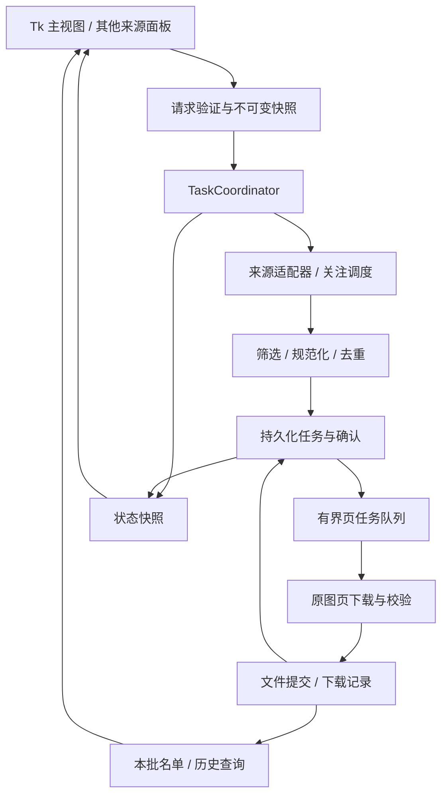

# 01 架构与契约

版本：v1，2026-10-21。属于[详细设计](README.md)；本页定义目标契约，不表示代码已经具备这些接口。

## 1. 架构选择与边界

保留模块化单体：一个 Python 进程、一个 Tk 根窗口、项目内源码和资源；不引入 Web 服务、Node、消息中间件、插件系统或另一套 ORM。先在已有模块旁增加明确的任务协调边界，再逐步让旧入口适配。

首版一次运行一个活动批次，待选任务可以有多个。批次内部允许来源查询与有限图片页下载重叠；所有来源共用调度和预算。窗口数量不决定线程数、数据库连接数或网络并发。

## 2. 现有模块的处理方式

| 当前源码 | 已有职责 | 目标处理 |
| --- | --- | --- |
| [models.py](../../../core/models.py) | 冻结的 `DownloadTask`，兼容旧 11 值解包 | 保留旧类型和适配器；新任务契约逐步增加，不直接改变旧元组长度 |
| [download_engine.py](../../../core/download_engine.py) | HTTP 传输、原图元数据、路径 | 优先修复校验；传输返回结构化结果，兼容入口仍映射旧返回值 |
| [download_service.py](../../../core/download_service.py) | 原图解析、多页展开、记录与布尔返回门面 | 保留门面；新管线明确在一处展开页任务，禁止再次递归展开 |
| [download_task_store.py](../../../core/download_task_store.py) | 持久化作品任务、内存队列、失败恢复 | 提取已验证的入队前持久化原则；新实现使用单库页待办，旧表仅作可选导入 |
| [follow_crawl_service.py](../../../core/follow_crawl_service.py) / [follow_crawl_state.py](../../../core/follow_crawl_state.py) | 关注快照、画师分页游标、追加/取消关注、增量扫新 | 复用稳定 ID 与断点；将推进游标的确认绑定持久化待办 |
| [fetch_strategies.py](../../../core/fetch_strategies.py) 与 fetcher mixin | 多来源查询，部分隐式回退 | 统一来源结果契约；回退意图可见；不在来源内部启动下载池 |
| [multi_filter_fetch.py](../../../core/multi_filter_fetch.py) | 各来源有限集合求交 | 使用同一查询、筛选、预算与覆盖说明 |
| [record_manager.py](../../../core/record_manager.py) / [sqlite_record_repository.py](../../../core/sqlite_record_repository.py) | 页记录、兼容投影、可信旧记录去重 | 新 library_repository 统一成果与任务事实；旧记录可选只读导入，不维持整套兼容物化 |
| [pixiv_api_policy.py](../../../core/pixiv_api_policy.py) / [http_client.py](../../../core/http_client.py) | 请求退避、会话管理 | 调度层统一预算和冷却；会话由使用者归还 |
| [app_paths.py](../../../core/app_paths.py) / [config_manager.py](../../../core/config_manager.py) | 根路径解析与配置 | 继续复用，加入版本化路径引用和配置映射 |
| [main_controller.py](../../../gui/main_controller.py) / GUI mixin | 输入、工作线程、状态与界面耦合 | 控制器只提交命令和映射视图，逐步抽出任务生命周期 |
| [logger.py](../../../utils/logger.py) | 会话落盘与 UI 队列 | 保留兼容日志调用入口，内部按 06 改为有界异步通道 |

建议新增 `core/task_coordinator.py`、`core/task_contracts.py`、`core/library_repository.py`；必要时再拆来源与查询适配。这些是候选落点，不要求每个逻辑职责都新建文件；不得为文件数或行数目标拆空壳。

## 3. 统一名词和标识

| 名词 | 定义 / 标识 | 关键约束 |
| --- | --- | --- |
| Job（任务） | 一份持续的收集意图，`job_id` 随机唯一 | 可跨多批继续；与旧关注 `run_id` 建立映射 |
| Batch（批次） | 用户一次开始/继续到本次停止，`batch_id` | 保留条件版本、预算、结束原因和本批名单 |
| Work（作品） | `illust_id`，数字按字符串处理 | 计数按作品去重，不按来源出现次数累加 |
| Page（图片页） | `illust_id + page_index`，页序从 0 开始 | 不以 p0 或作品 ID 替代全页状态 |
| Delivery（交付） | 某页、某目标、某品质的保存尝试链，`delivery_id` | 重试复用 ID；显式另存或重下创建新代次 |
| Source occurrence（来源出现） | 来源、实际日期/名次、作品 | 可多条关联同一作品；不多次下载 |
| Coverage（覆盖情况） | 已查看范围、是否穷尽、停止原因、字段未知数 | 来源穷尽与图片全部交付是两个判断 |

输出目标身份使用稳定的 `output_root_id + 相对文件路径 + 品质标识`，不把项目绝对盘符作为持久身份。旧 `task_identity` 使用绝对路径哈希，迁移映射见 04；不能修改字符串后假称旧 ID 自然兼容。

## 4. 请求与数据契约

以下是字段契约，可用标准库 `dataclass(frozen=True)` 实现；序列化使用版本化 JSON，不允许序列化控件、线程、会话或凭据。

| 对象 | 必要字段 | 校验 / 语义 |
| --- | --- | --- |
| `QuerySpec` | `schema_version, source, parameters, requested_sort, filter_spec, query_budget` | source 为已注册来源；参数按来源验证；日期保留语义与时区 |
| `FilterSpec` | `min_bookmarks` 为 int 或 null，`exclude_ai` 为 bool | null 表示关闭收藏筛选；0 合法但不等于未知；后续条件显式扩展版本 |
| `DownloadRequest` | `request_id, schema_version, account_ref, query, output_spec, quality_spec, dedup_policy, batch_budget` | 提交后不可变；仅保存非秘密账户引用 |
| `OutputSpec` | `root_ref, folder_by_artist, name_template` | 模板只允许白名单字段；路径越界、设备名、冲突在写文件前处理 |
| `QualitySpec` | `original, all_pages, validation_policy_version` | 新配置原图/多页开启；旧显式值保留并准确标注 |
| `WorkCandidate` | `illust_id, artist_id/name, title, page_count?, page_urls, bookmarks?, ai_flag?, published_at?, provenance` | 字段缺失用 null；URL 来自已验证元数据，展示层不请求图片 |
| `SourcePage` | `items, cursor_before, cursor_after, page_identity, exhausted, actual_sort, coverage` | 只有该页候选处理已持久化，才确认 cursor_after |
| `PageTask` | `delivery_id, job_id, origin_batch_id, work/page, output_ref, source_ref, quality, generation` | URL 可刷新，作品页和输出身份不能随重试变化；无 Token/Cookie |
| `PageResult` | `delivery_id, state, bytes, verification_level, artifact_hash?, error_code?, retried` | 完成依据 02 的文件与记录提交；不是 HTTP 返回成功就完成 |
| `TaskSnapshot` | `job_id, batch_id, revision, phase, activity, counters, coverage, stop_reason` | 可合并旧快照；revision 单调递增，拒绝迟到值 |

`origin_batch_id` 表示首次产生待办的批次，最终交付另记 `completed_batch_id`。恢复失败页时，本次确实写成的图片计入本次新增，不重复计入旧批次。

预算分三类，不能混用：查找预算（请求/候选/运行时间）；本批最多新增/补齐作品数；资源容量（在途页、字节缓冲）。恢复待办纳入本批作品名额，已有完整作品与条件过滤不占名额，但查询仍消耗请求预算。

## 5. 接口边界

| 接口（目标） | 输入 → 输出 | 失败与幂等 |
| --- | --- | --- |
| `validate_request` | 草稿 → 规范请求或字段错误集合 | 不联网、不写库；保留用户输入供纠正 |
| `submit` | request + command_id → job/batch 标识 | 重复 command_id 返回原结果；持久化失败不启动 |
| `pause / cancel / resume` | job_id + command_id → 命令确认；resume 可附下一批资源预算 | 确认是已接收命令，不冒充线程已停止；新预算不改变原条件快照 |
| `fetch_page` | query + cursor + budget/control → SourcePage | 空结果与请求错误分开；不自行推进持久游标 |
| `accept_candidate` | candidate + request → 已有/过滤/待补字段/页待办 | 同事务保存本批结果与待办，再返回可确认的凭据 |
| `ack_source_page` | page_identity + 已持久化候选凭据 → 游标确认 | 重复确认安全；缺候选凭据不得越过 |
| `download_page` | PageTask + auth resolver + control → PageResult | 写入和提交见 02；不访问 Tk、不扩展其他页 |
| `query_results` | batch/job/artist 条件 + 分页游标 → 行与下一页游标 | 仅本地查询；不触发采集、原图探测或全库重建 |
| `export_results` | 查询条件快照 + export_id → 进度/完成路径 | 后台流式、可取消；失败不修改下载事实 |

旧门面需要布尔或二元组结果时，由适配器转换；未知长度待核验、记录待恢复、部分页失败不能转换为 True。统计通过结构化事实更新，不能读取中文日志来判断。

## 6. 状态机

批次 `phase` 为唯一控制状态；`activity` 可同时含 `fetching` 和 `downloading`，不强迫流水线只有一个活动。

| phase | 进入条件 | 合法后续 / 显示 |
| --- | --- | --- |
| `queued` | 请求及批次已持久化 | running / cancelled |
| `running` | 持有活动批次所有权 | cooling / pausing / cancelling / settling |
| `cooling` | 受共享限流控制，保存 retry_at | running / pausing / cancelling；显示时间和范围 |
| `pausing` | 用户暂停或资源预算停止派发 | paused / blocked；等待写入和线程收尾 |
| `paused` | 断点稳定，本批结束 | 继续创建下一批次；历史批次不改写为 running |
| `cancelling` | 取消继续工作，保存已有结果 | cancelled / blocked |
| `settling` | 来源停止，待办排空或结果核对 | completed / partial / paused / blocked |
| `completed` | 所请求覆盖成立，所需页交付，无未决项 | 终态；可新建续收任务 |
| `partial` | 本批终止且有失败/未知/不可访问/未支持项 | 终态；可创建失败项重试批次 |
| `cancelled` | 已停止派发，活动线程退出，待办标为取消保留 | 终态；不删除成果；可复制未完成项 |
| `blocked` | 认证、磁盘、数据库或收尾故障阻止继续 | 原因解决后显式创建恢复批次 |

来源预算用尽时停止查询，已接收页可排空后进入 paused；用户暂停/取消则要求传输尽快在安全边界退出，不等待整条队列下载完。长任务 Job 的聚合状态由最新批次、覆盖和未决待办推导，旧批次保留原始结果。

图片页交付状态：`pending → transferring → validating → prepared → completed`；失败可到 `retry_wait / failed / needs_verification`，中止到 `suspended / cancelled`，文件发布与账本确认之间中断到 `recovery_needed`。`skipped_existing`、`filtered`、`metadata_unknown`、`unavailable`、`unsupported` 是本批候选结果，不是假造的下载成功状态。

## 7. 必须始终成立的约束

1. 来源游标不能领先于候选决策和下载待办的持久化；重复抓取允许，漏交付不允许。
2. 正式文件完成和页记录完成必须可恢复对账；新库内部原子提交不等于文件系统也加入事务，仍需 prepared 恢复协议。
3. 每个目标路径最多一个写入者；每个命令/交付事实最多记一次。
4. 所需页完整才计作品完成；只下载首图的任务必须标为“所选 1 页完成”。
5. 条件过滤不是永久完成；放宽筛选或升级全页要求后能补查。
6. 已有可信记录对应文件被用户搬走时，普通去重仍跳过；核验和重下必须有独立范围。
7. UI 丢掉进度显示不影响业务事实；日志失败不能产生“文件已完成”假记录。
8. 取消、切页或关闭详情不关闭其他所有者仍使用的资源。
9. 旧来源未完成适配前保留原入口；任何功能切换有独立验收与回退界限。

## 8. 错误协议与兼容

错误至少含 `code, category, retryable, scope, safe_message, retry_at?, work/page?`。类别固定为参数、认证、权限、限流、网络、远端内容、完整性、文件系统、记录存储、取消、内部错误；异常原文先脱敏，再进入诊断日志。

同一故障不在 HTTP 层、来源层、任务层各重试三次。重试预算由协调器分配给操作，底层报告尝试结果。旧代码自带的重试在适配时明确关闭或纳入同一预算。

P1 暂时保持旧 11 元组及下载门面的返回形状，以控制质量修复范围。新核心不永久继承这些内部契约；外部仍需的入口通过显式适配提供。旧格式记录是可选导入/导出边界，不继续约束每次下载的实时写入。功能切换前保留可运行旧版本。

## 9. P2 已实现的边界

2026-10-21 第二轮已新增 [task_contracts.py](../../../core/task_contracts.py)、[library_repository.py](../../../core/library_repository.py)、[library_paths.py](../../../core/library_paths.py) 和 [task_coordinator.py](../../../core/task_coordinator.py)，通过隔离验收后合入，生产入口和旧库尚未切换。

实现类型 `CollectionRequest` 对应本文的收集请求，避免与旧下载引擎已有的 HTTP `DownloadRequest` 混名。嵌套条件冻结，JSON 严格校验；`SourcePage` 接纳与游标同事务，页收据按任务/来源/轮次/实体/页标识区分。恢复待办在新批次首次 claim 时接纳并占作品名额，同作品多页不重复占额。

协调器命令返回 Future，普通命令与停止命令分开设界限，页队列只装 ID；写入队列同时限制条数和总字节。启动只本地对账，显式 `run_queued` 才派发。当前 executor 的“完成”返回不能替代持久完成凭据；真正文件交付由 P3 接入。
