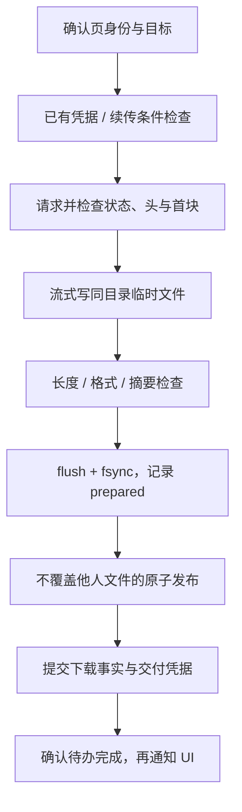

# 02 原图与下载完整性

版本：v2，2026-10-21。目标契约见 [01](01_ARCHITECTURE_AND_CONTRACTS.md)，交付凭据与恢复表见 [04](04_RECORDS_AND_MIGRATION.md)。P3 的实际发布原语和验证边界见第 7 节，实施证据见[进度](../REFACTOR_PROGRESS.md)。

## 1. 质量标准与适用范围

对新下载做到：使用确切原图地址，保存来源字节，不缩放、转码、重压缩或伪造扩展名；所需页全部交付；不把 HTTP 错误正文、拼错的续传或半文件报为成功。

本轮不承诺用文件头、长度或 SHA-256 证明图片所有像素都能解码。验证等级进入记录，区分旧记录可信、传输长度核对、容器结构核对和深度解码；深度解码并非首版已有能力。

现有两项隔离复现作为必修回归：200 + HTML 不能成功；请求 `bytes=4-` 却收到 `bytes 0-5/10`，不得追加成长度恰为 10 的错误文件。复现不证明用户真实库已有损坏。

## 2. 原图与多页解析

1. 优先复用 App API 已返回的逐页原图地址及页数。必须校验作品身份、列表与页序完整性，不将 `img-master` 当作原图。
2. 缺少元数据才通过现有受限速的 Ajax 回退补齐；相同作品并发请求合并，缓存有容量和生命周期，不永久缓存认证失败。
3. 元数据仍不完整时保留 `metadata_unknown` 或失败原因；不得拼接猜测所有页的扩展名、以 p0 地址代替其他页。
4. 新管线在作品进入待办时只展开一次页任务；调用旧 `download_image` 适配器时关闭再次展开。页下载层只处理指定页。
5. `all_pages=false` 只选择 p0，完成文案为“所选 1 页完成”。以后切换全页时补缺页，已有 p0 不重复下。
6. 作品页数变化时刷新元数据并新增缺页；保留旧文件，不自动删除减少的页。作品内容更换但页数不变时，普通去重仍信任旧记录，显式核验/更新原图才产生新交付代次。

原图 URL 与页次绑定；实际图片格式由来源元数据、HTTP 与内容共同核对。JPEG/PNG 为首批必须通过的类型；GIF/WebP 等必须通过各自格式检查后才可原样保存。扩展名、明确 MIME 与实际格式发生冲突时保留为待核验，不静默改名掩盖。未支持格式、动图专用资源和小说等单列 `unsupported`，不能保存一个静态预览并声称作品完整。

## 3. 目标路径与已有文件

| 情况 | 操作 |
| --- | --- |
| 已选择导入且信任的旧完成记录，文件被搬走 | 按正常去重跳过，标记“已有历史记录”；全新收集模式不依赖该记录 |
| 当前交付已有匹配完成凭据 | 返回幂等完成/已有结果，不重复记账 |
| 有本交付的 `.part` 和有效恢复元数据 | 按第 5 节判断能否续传 |
| 有同名正式文件但无法证明身份 | 不覆盖、不仅凭大小跳过；生成带作品 ID/页序的确定性冲突名或报告冲突 |
| 旧版直接写出的疑似残片 | 作为未验证旧文件保留；仅在明确恢复/核验范围内处理，不当作可信续传片段 |
| 路径包含非法字符、Windows 设备名或尾随点/空格 | 命名规则规范化，保留作品 ID 与页序；生成结果仍须在允许根目录内 |
| 模板生成同名、超长路径、目录无权限、磁盘空间不足 | 写入前给具体原因；不覆盖其他作品，不把未知错误当网络重试 |

运行时输出路径由根引用解析，用户选定的项目外目录同样合法。远端标题不能引入 `..` 或绝对路径。父目录解析不得通过链接逃离目标根；网络重定向也不得把认证头无条件发到新主机。

## 4. 单页传输流程

- 临时文件形如 `<最终文件名>.<delivery_id>.part`，在目标同目录；恢复信息存入待办库，不另建每块都写的 JSON 文件。
- 首块最多保留 64 KiB 用于识别，之后按块流式写。块大小和队列预算见 06；不把整张图装入内存。
- 请求使用 `Accept-Encoding: identity`。若响应仍有非 identity 的内容编码，首版拒绝进入 Range 拼接并给出原因；不可把压缩传输字节长度和自动解码后的文件长度混为一谈。
- 普通完整 GET 从实际响应取得长度。移除常规“先 GET 取长度，再 GET 下载”的重复探测；恢复、版本核验确需探测时才额外请求，计入预算。
- 一切网络、重试等待、磁盘写入、校验和完成提交均在 UI 线程外执行。

## 5. HTTP 与续传决策

协议依据：`If-Range` 用于在表示改变时取得完整响应，弱 ETag 不能作为它的实体标签；无效 `Content-Range` 不得与已有片段合并。[RFC 9110 §13.1.5](https://www.rfc-editor.org/rfc/rfc9110.html#section-13.1.5)、[§14.4](https://www.rfc-editor.org/rfc/rfc9110.html#section-14.4)。下面是本项目的严格处理策略。

| 请求/响应 | 本项目动作 |
| --- | --- |
| 全量请求得到 200 | 写新临时文件；实际字节与可信 Content-Length 比较 |
| 全量请求意外得到 206 | 不猜测它是完整图，报告协议错误；允许在总尝试预算内重新全量请求 |
| 从偏移 n 续传得到 206 | 必须为单一 bytes 区间、起点恰为 n，终点 ≥ n，已知总长 > 终点；版本信息一致 |
| 206 的正文长度与区间长度不符 | 拒绝本段；不将片段提升为正式文件 |
| 206 只返回剩余区间的一部分 | 保存已校验前缀，继续请求剩余区间，受总尝试/时间预算约束；未到总长不成功 |
| Range 请求得到 200 | 当作全新表示；从新临时文件完整写，不向旧片段追加 |
| 206 缺/错 Content-Range、multipart、单位不支持 | 拒绝追加，原已确认片段保留；在预算内最多切换一次全量重试 |
| 416 | 长度相等也不能直接完成；用已有版本/校验凭据判定，否则重新全量取得或待核验 |
| 304、204 或空正文 | 不作为图片成功 |
| 401/403 | 区分认证失效、作品权限与 CDN URL 失效；只允许一次元数据刷新尝试，持续失败保留原因 |
| 404/作品删除 | 当前授权下不可访问；保留记录，不通过无限重试补齐 |
| 429/503 Retry-After | 提交共享冷却策略；等待可取消，不另开来源绕过 |
| 网络超时/连接中断 | 保存可恢复片段，按统一尝试预算有限重试 |

续传记录至少包含 `delivery_id、source_identity、strong_etag?、expected_total?、verified_prefix_bytes、prefix_hash、format、validation_policy_version`。弱 ETag、仅 Last-Modified、仅 URL 与长度相等不足以证明片段同版；v1 默认在缺少强版本依据时全量重取。不得为了带宽收益牺牲拼接正确性。

确认偏移的保存先 flush/fsync 文件，再提交前缀大小和摘要；频率参数见 06，暂停立即提交。活动传输保留流式哈希状态，不在每次检查点重读整个文件；跨进程恢复时只流式重算一次前缀，不能 pickle 哈希对象作为可信恢复数据。

崩溃后临时文件可能长于最后持久化的确认偏移：先验证已记录前缀的摘要，未确认尾部不参与拼接。只有本程序明确拥有的临时文件可截到确认偏移；身份/摘要不符时保留供诊断并重新下载，不操作用户原始文件。

## 6. 内容与完整性检查

| 检查 | 规则 | 验证等级 |
| --- | --- | --- |
| 状态与错误正文 | 拒绝 HTML/JSON/XML 错误正文，即使 HTTP 200 | 不通过则 failed |
| MIME | image 类型只是线索；缺失或 octet-stream 结合签名判断；明确冲突报告 | 不能单独证明成功 |
| 格式签名 | 校验 JPEG、PNG、GIF、WebP 等支持类型；不自动把未知内容改名为 jpg | `format_checked`（中间证据） |
| 长度 | 正常结束且实际大小等于可信完整长度；续传额外满足版本、区间和总长 | `length_checked` |
| 容器结构 | PNG 分块长度、顺序、CRC、IEND；其他格式使用已实现且有样本的结构检查 | `structure_checked`，不称像素解码通过 |
| 内容摘要 | 流式 SHA-256；用于恢复、身份和文件变动检查 | 本地摘要，无服务器独立摘要时不称端到端校验 |
| 只有 EOF、没有可信长度或足够结构依据 | 保存为 `needs_verification`，不增加已验证完成数，不丢弃已收字节 | 未决 |

可信长度指本次未转换内容表示的有效 HTTP 长度，或与当前强版本绑定的总长；旧探测长度不能压过本次不同版本。有效 chunked 结束可证明传输边界，但不独自证明图片结构完整；未知长度 PNG 若完整结构校验通过可完成，未知长度 JPEG 在未实现可靠结构检查前进入待核验。

格式检查必须限制单块长度、整数溢出和 CPU 工作量；不按不可信尺寸分配整幅像素缓冲。正常图片无需为校验安装图片库。新增格式校验能力单独增加样本与反例，不能只有“文件头正确”测试。

## 7. 文件发布与记录提交

1. 临时文件完成验证，flush、fsync 并关闭句柄；记录最终摘要、大小、目标和校验等级。
2. 待办库提交 `prepared`。提交失败则保留临时文件并停止发布，不能先通知成功。
3. 在路径所有权检查下，原子发布正式文件，拒绝覆盖既有目标。P3 当前使用同目录 `os.link(temp, final)`，确认提交后再清理属于本交付的临时目录项；两个名字指向同一文件，不复制图片字节。目标已存在时必须核对文件身份、大小和完整摘要，不能不加判断地 `os.replace` 用户文件。不支持硬链接的文件系统会保留 prepared 并阻塞，尚无降级发布方案；实际输出盘在 P8 验证。
4. 新单库在一个事务中写 artifact、唯一 `delivery_id` 凭据、完成事件、待办完成与 `completed_batch_id`。
5. 提交后发布 UI 快照；下载名单由同库查询，不通过日志推导。
6. Markdown 按批次或显式请求导出；输出失败只影响导出，不重下图片，不要求持续重写旧 JSON 文件。

文件发布与数据库提交之间允许短暂中间状态，必须按 04 的恢复表处理；数据库内完成事实一次提交，文件系统仍不属于该事务。关键提交使用 FULL，硬件/文件系统仍影响断电持久性，不把 `fsync` 说成任何场景都绝对安全。

P3 当前验证等级是 `structure_checked`：检查受支持 JPEG/PNG/GIF/WebP 的结构、长度及摘要，保留原始字节，不宣称逐像素完整解码。启动恢复每次最多检查 200 个 prepared/recovery_needed 条目，不发 HTTP；已完成记录不做全库文件扫描。旧 UI 尚未接入此协议，不能把核心离线通过扩大为整软件或真实下载已验收。

## 8. 中断、重试与多页结果

- 用户暂停：停止新派发，当前传输在检查点退出，保留已确认片段；仍在 prepared/提交中的页优先完成可恢复收尾。
- 网络重试与完整性重试共用每页总尝试预算，默认起点为 3 次总尝试。认证、写盘失败、路径冲突不按网络错误反复尝试。
- 重试恢复只计一次成功，同时保留 `retried=true`；一次尝试失败不能提前增加最终失败页数。
- 三页作品：p0 已有、p1 成功、p2 失败 → 已有 1 页、新增 1 页、失败 1 页、作品部分完成。重试仅安排 p2；作品全页完成时只增加一次。
- `needs_verification` 不被“仅重试网络失败”默默覆盖；详情提供原因与显式重取操作。

## 9. 本专题验收

覆盖 200 HTML、伪 MIME、空文件、正常 JPEG/PNG、混合扩展名、多页 URL 不规则；正确/错误 206、全量回退、416、版本改变、未知长度、编码冲突；中断、磁盘满、权限拒绝、目标冲突、杀进程恢复，以及记录/名单输出失败。

每种失败必须同时断言：正式文件是否存在、临时文件如何保留、待办状态、下载主库记录、本批统计。仅检查返回 True/False 不足以证明完整性。详细矩阵与工作包见 [07](07_IMPLEMENTATION_AND_ACCEPTANCE.md)。

## 10. 已实现的独立结构检查

2026-10-21 新增 [image_validation.py](../../../core/image_validation.py)。检查 PNG 分块/CRC、受限 zlib 流与扫描行，JPEG 标记/扫描段/EOI，GIF 分块/帧/终止符，以及静态 WebP RIFF/分块/尺寸，并计算源字节 SHA-256。读取与解压分块有界，不分配像素图；等级为 `structure_checked`，不宣称 JPEG/GIF/WebP 像素解码通过。

APNG 与动画 WebP 当前进入明确的 `needs_verification`，保留字节；不能用已实现的静态结构检查给未覆盖的动画帧报完成。独立 25 项测试覆盖全部参考样本的每个截断位置、伪签名、CRC/deflate/扫描行错误、MIME/长度冲突、取消与内存上限。WebP 参考样本由本机隔离离线 Chrome 生成并实际解码，浏览器只用于一次性样本核验，应用和测试运行不增加浏览器依赖。

格式依据：[W3C PNG](https://www.w3.org/TR/png-3/)、[GIF89a](https://www.w3.org/Graphics/GIF/spec-gif89a.txt)、[Google WebP 容器](https://developers.google.com/speed/webp/docs/riff_container)、[libjpeg-turbo 标记解析](https://github.com/libjpeg-turbo/libjpeg-turbo/blob/main/src/jdmarker.c)。完整文件交付与恢复仍以 P3 的后续验收为准。
